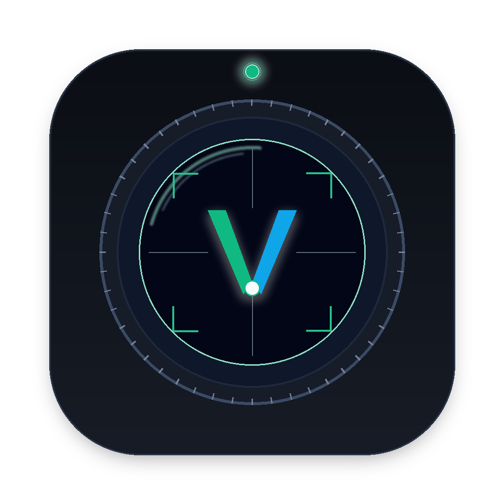

<div align="center">



# Modu Vision (모두의 비전)

**데이터 준비부터 라벨링, 학습, 평가, 검사 플로우와 모델 내보내기까지 연결하는 데스크톱 비전 AI 스튜디오**

[](https://github.com/JaeHongChoe/modu-vision/actions/workflows/ci.yml)
[](package.json)
[](CONTRIBUTING.md)
[](package-lock.json)
[](https://github.com/JaeHongChoe/modu-vision/actions/workflows/windows-native.yml)
[](LICENSE)

[작업 흐름](#작업-흐름) · [주요 기능](#주요-기능) · [빠른 시작](#빠른-시작) · [패키징](#데스크톱-패키징) · [문서](#문서)

</div>

## 프로젝트 소개

Modu Vision은 Electron·React 화면과 Python·FastAPI 학습 엔진으로 구성됩니다. 앱 이름은 **Vision AI Studio**입니다. 프로젝트의 이미지와 라벨, 학습 작업, 저장 모델, 평가 결과와 검사 이력을 연결해 관리합니다. 저장한 플로우를 데스크톱에서 실행하거나, 실행 패키지와 독립 검사 서비스로 내보낼 수 있습니다.

현재 버전은 **0.1.0, 개발 단계**입니다. 코드 구현, 자동 테스트, 실제 앱 실행, 대상 OS의 설치·복구, 현장 장비와 모델 품질의 검증은 각각 구분합니다. 플랫폼별 빌드·서명·실행 조건은 [배포 지원 표](docs/release-platform-matrix.md), 기능별 구현·확인 범위는 [작업 계획](docs/service-upgrade-program.json)과 [검증 근거](docs/service-upgrade-evidence.json)를 확인하세요.

## 작업 흐름

번호가 있는 Studio 화면은 다음 **6단계**입니다. 별도의 운영자 검사 작업 공간과 작업 센터에서 실행과 이력을 관리할 수 있습니다.

| 단계 | 화면 | 주요 작업 |
| --- | --- | --- |
| 1 | 데이터 관리 | 이미지·LabelMe 가져오기, 데이터 분할·버전 관리, 합성 후보 관리 |
| 2 | 라벨링 & AI | 도형·마스크 편집, 라벨 세트, 팀 기준서·배정·검수 |
| 3 | 오토딥러닝 | 모델·실행 자원·학습 설정 선택, 후보 탐색, 작업 상태 확인 |
| 4 | 평가 & 과검/미검 | 이미지별 결과, 임계값 검토, 동일 이미지 기준 모델 비교·보고서 |
| 5 | 플로우차트 | 모델·ROI·측정·집계 연결, 저장·테스트·일괄 평가 |
| 6 | 추론 & 모델 내보내기 | 저장된 플로우 실행, 결과·검토 이력, 모델·전체 플로우 패키지 내보내기 |

## 주요 기능

### 데이터와 라벨링

- 폴더·지원 LabelMe 형상 가져오기, 데이터셋 분할과 버전·원본 출처 관리
- BBox, 회전 BBox, polygon, brush·eraser와 자동 선택 도구
- 확대·이동·화면 맞춤과 픽셀 확인, 선택 형상 이동, 실행 취소·다시 실행
- 원본을 유지하는 파생 이미지 편집과 라벨 세트 관리
- 프로젝트별 라벨 기준서, 담당 배정·우선순위, 편집 잠금, 1인·2인 검수와 의견 조정
- 선택적 승인 입력 정책: 라벨·기준·정책이 바뀌면 이전 검수를 무효화하고 학습 입력의 출처 기록

### 10개 모델군

| 모델군 | 구현된 학습·처리 경로 |
| --- | --- |
| 이미지 분류 | DINOv3 기본 구조와 ResNet·ConvNeXt·EfficientNet 대체 구조 |
| 영역 분할 | DINOv3 기반 분할과 U-Net 경로 |
| 객체 검출 | YOLO 기본 구조와 Faster R-CNN 대체 경로 |
| 이상탐지 | PaDiM·PatchCore 통계 구성, DINOv3 합성 결함 학습 |
| 패치 분류 | 원본 해시·패치 좌표·클래스를 연결한 학습 |
| 문자 인식 | CTC 인식, 수평 문자 영역 제안, 다중 줄 정렬과 문자열 규칙 |
| 회전 객체 검출 | 회전 박스 모델과 명시적으로 가져온 로컬 YOLO OBB 가중치 경로 |
| 정방향 보정 | 정답 보정각을 이용한 각도 예측 |
| 이미지 개선 | 개선 전·후 정답 이미지 쌍을 이용한 학습 |
| 결함 이미지 생성 | 결함 crop GAN 학습, 후보 생성·검토·train 입력 채택 |

GAN은 생성 데이터를 검토해 학습에 채택하는 용도이며, 검사 플로우의 판정 모델로 사용하지 않습니다. OCR의 영역 제안은 고전적 수평 영역 분석 방식입니다. 모델군별 의존성·입력·실행 단계는 [모델 카탈로그](backend/engine/model_catalog.py)에 정의되어 있습니다.

### 학습과 평가

- 사용 가능한 CPU·Apple MPS·CUDA 자원과 SSH 원격 실행 프로필 선택
- 로컬·SSH 후보 탐색: 지원 recipe 안에서 후보 수·시간·자원 예산을 제한하는 AutoDL
- 학습 상태·loss·자원 사용량 표시, 작업 취소·재연결·재열기와 부모 모델 연결
- 호환성을 검사한 체크포인트에서 학습 재개, 준비 입력과 저장 모델의 식별자·해시 기록
- 이미지별 예측, 혼동 행렬과 과검·미검 사례, 같은 이미지 집합에 대한 두 모델 비교
- HTML·JSON 보고서 생성과 브라우저 인쇄를 통한 PDF 저장

직접 학습과 자동 후보 탐색의 지원 범위는 다릅니다. 원격 AutoDL은 단일 CPU/CUDA worker 경로이며, exact resume·다중 줄 OCR·네이티브 YOLO OBB 후보 등에는 제한이 있습니다. 학습 화면의 준비 검사와 선택한 recipe의 지원 범위를 확인하세요.

### 검사 플로우와 운영자 작업 공간

- 모델, ROI, 전처리, Blob 측정과 결과 집계를 연결하는 플로우 편집·저장·실행
- 운영자 검사 화면의 수동 입력, 프로젝트 폴더 감시, 카메라·RTSP 입력 경로
- 부품·제품·Lot와 재검사 연결, 모델 판정과 운영자 검수 분리
- 접수 시 검사 recipe 고정, 용량이 제한된 입력 대기열과 backpressure, 재처리·ACK 전송 재시도
- 검사 결과와 검토 이력 조회, CSV·JSON 내보내기

### 패키지와 외부 연동

- 그래프·모델·체크섬을 함께 묶는 전체 플로우 패키지와 패키지 보관함
- 앱과 별도로 실행하는 검사 서비스, 인증된 HTTP 작업 접수와 결과 내보내기
- Python·CLI·REST 연동, CPython 런타임을 사용하는 C ABI/C++·C# 래퍼
- 단계 적용·롤백, drift·sampling, 보존 정책·복구 가능한 휴지통과 진단 자료
- macOS LaunchAgent, Linux systemd user, Windows 로그온 작업을 통한 사용자 시작 등록
- 별도의 Windows SCM 서비스 사전 검사·등록 파일 준비·등록 경로. 관리자 권한과 서비스 계정 등 대상 환경의 사전 조건 필요

통합 방법은 [검사 서비스·SDK 안내](docs/api-integration.md)와 [학습 CLI·REST 안내](docs/training-engine-cli-rest.md)를 참고하세요.

## 빠른 시작

### 개발 환경

**Git, Node.js 24, Python 3.13**을 준비합니다. 고정 버전은 **Python**: 3.13, **Node.js**: 24, **Electron**: 44입니다(Electron 44는 `package-lock.json`이 고정합니다). Windows·Linux 명령은 CPU용 해시 잠금 파일을 사용합니다. macOS arm64는 별도 잠금 파일이 없어 `requirements.txt`를 사용합니다. GPU 학습에는 장치에 맞는 드라이버와 Python 의존성 구성이 추가로 필요합니다.

### 1. 저장소 받기

```bash
git clone https://github.com/JaeHongChoe/modu-vision.git
cd modu-vision
```

### 2. 운영체제별 설치·실행

<details>
<summary><strong>Windows 11 x64 · PowerShell</strong></summary>

가상환경의 Python과 `npm.cmd`를 직접 사용합니다.

```powershell
py -3.13 -m venv .venv
.venv\Scripts\python.exe -m pip install --require-hashes --only-binary=:all: -r build/ci/requirements-windows-py313-cpu.lock
npm.cmd ci
$env:VISION_AI_PYTHON = (Resolve-Path .venv\Scripts\python.exe).Path
npm.cmd run dev
```

자세한 첫 실행·문제 해결 순서는 [Windows 빠른 시작](docs/quickstart-windows.md)을 확인하세요.

</details>

<details>
<summary><strong>macOS arm64 · zsh 또는 bash</strong></summary>

```bash
python3.13 -m venv .venv
source .venv/bin/activate
python -m pip install -r requirements.txt pytest==8.3.4
npm ci
export VISION_AI_PYTHON="$PWD/.venv/bin/python"
npm run dev
```

</details>

<details>
<summary><strong>Linux x64 · bash</strong></summary>

```bash
python3.13 -m venv .venv
source .venv/bin/activate
python -m pip install --require-hashes --only-binary=:all: -r build/ci/requirements-ubuntu-py313-cpu.lock
npm ci
export VISION_AI_PYTHON="$PWD/.venv/bin/python"
npm run dev
```

</details>

`npm run dev`가 Vite 개발 서버, Electron 코드 감시와 데스크톱 앱·백엔드를 실행합니다. 백엔드 Python 코드를 바꿨다면 앱을 재시작하세요.

**사전학습 가중치는 소스와 기본 설치본에 포함되지 않습니다.** 해당 모델을 사용하려면 제공자에게서 내려받거나 사용자가 가져와야 합니다. 오프라인 사용에는 허용된 가중치와 선택적 런타임을 미리 준비해야 합니다. DICOM·OpenVINO·의미 기반 라벨링 등의 선택적 환경은 해당 기능의 준비 조건을 확인하세요.

### 3. CPU 데모

설치 후 작은 합성 이미지로 정방향 보정 모델을 학습·평가할 수 있습니다. GPU와 가중치 다운로드는 필요하지 않습니다.

```bash
python scripts/cpu_demo.py
```

Windows에서는 `python` 대신 `.venv\Scripts\python.exe`를 사용합니다. 결과를 보존하려면 `--keep` 또는 `--workdir 경로`를 지정하세요. 데모 데이터와 작업 기록은 격리된 작업 폴더에 저장됩니다.

## 개발 검사

변경한 영역의 백엔드 테스트와 타입·화면 검사를 먼저 실행합니다.

```bash
python -m pytest backend/tests/test_service_s1_04.py -q
npm run typecheck
npm run test:renderer
npm run build
```

화면 검사는 `npm run test:e2e:browser`, 데스크톱 검사는 `npm run test:e2e:electron`입니다. Playwright 브라우저와 테스트용 Python 설정, 회귀 범위는 [기여 안내](CONTRIBUTING.md)에 있습니다. Windows에서는 `npm.cmd`와 가상환경 Python을 사용하세요.

## 데스크톱 패키징

**대상 OS·아키텍처에서 frozen 백엔드를 먼저 빌드한 뒤 Electron 패키지를 만듭니다.** 패키지 빌더는 백엔드의 실행·체크섬 기록과 소스 일치를 검사합니다. 다른 플랫폼의 백엔드 빌드 결과를 재사용할 수 없습니다.

빠른 시작의 의존성을 설치한 환경에 PyInstaller를 추가합니다. macOS 패키징에는 Xcode Command Line Tools(macOS SDK·clang), Linux 패키징에는 C 컴파일러와 해당 Python 개발 헤더가 필요합니다.

**macOS arm64**

```bash
.venv/bin/python -m pip install pyinstaller
.venv/bin/python scripts/build_backend_binary.py
npm run package:mac
```

**Windows x64 · PowerShell**

```powershell
.venv\Scripts\python.exe -m pip install --no-deps --require-hashes --only-binary=:all: -r build/ci/requirements-windows-packaging.lock
.venv\Scripts\python.exe scripts/build_backend_binary.py
npm.cmd run package:win
```

출력은 `release/`에 생성됩니다. macOS는 DMG·ZIP, Windows는 NSIS 설정을 사용하며 Linux x64의 AppImage·deb 빌드 경로도 있습니다. 설치본의 백엔드 Python 런타임은 번들에 포함됩니다. 플랫폼별 서명, 설치·제거·복구, 오프라인 준비 절차는 [배포 지원 표](docs/release-platform-matrix.md)를 따릅니다.

## 라벨링 단축키

캔버스에 포커스가 있을 때 사용합니다. 자동 선택과 100% 배율은 도구 모음에서 선택합니다.

| 키 | 동작 |
| --- | --- |
| `1` ~ `6` | 선택, BBox, 회전 BBox, polygon, brush, eraser 순서로 전환 |
| `F` | 이미지 화면 맞춤 |
| `Space` + 드래그 | 캔버스 이동 |
| 방향키 / `Shift` + 방향키 | 선택 형상 1px / 10px 이동 |
| `Ctrl` / `Cmd` + `Z` | 실행 취소 |
| `Ctrl` / `Cmd` + `Shift` + `Z` 또는 `Ctrl` / `Cmd` + `Y` | 다시 실행 |
| `Delete` / `Backspace` | 선택 라벨 삭제 |
| `Enter` / `Esc` | polygon 완성 / 현재 편집 취소 |

## 프로젝트 구조

| 경로 | 역할 |
| --- | --- |
| `src/main/`, `src/preload/` | Electron 실행, 백엔드 프로세스 관리와 데스크톱 bridge |
| `src/renderer/` | React Studio·운영자 화면과 상태 관리 |
| `backend/api/`, `backend/contracts/` | REST·WebSocket API, 인증·프로젝트 문맥과 실행 계약 |
| `backend/engine/` | 데이터·학습·평가·플로우 엔진과 독립 검사 서비스 |
| `backend/remote/` | SSH 원격 실행 조정자와 worker |
| `native_runtime/`, `examples/` | 외부 프로그램 연동 래퍼와 예제 |
| `backend/tests/`, `scripts/e2e/` | 백엔드 회귀와 브라우저·Electron 검사 |
| `build/`, `scripts/` | 패키징 설정, 의존성 잠금 파일과 개발·검증 도구 |
| `docs/` | 사용·연동·배포 안내와 기능별 구현·검증 기록 |

## 문서

| 문서 | 내용 |
| --- | --- |
| [기여 안내](CONTRIBUTING.md) | 새 환경 설치, CPU 데모, 테스트와 지원 범위 |
| [Windows 빠른 시작](docs/quickstart-windows.md) | Windows 설치·첫 실행·진단 |
| [문제 해결](docs/troubleshooting.md) | 오류 재현과 진단 자료 |
| [코드 읽기·리팩토링 검토](docs/CODE_GUIDE.md) | 핵심 진입점, 상태 구분과 구조 개선 우선순위 |
| [검사 서비스·SDK](docs/api-integration.md) | 전체 플로우 패키지, Python·CLI·REST·C++·C# 연동 |
| [학습 CLI·REST](docs/training-engine-cli-rest.md) | 외부 프로그램에서 학습 엔진 사용 |
| [배포 지원 표](docs/release-platform-matrix.md) | 네이티브 빌드, 서명, 설치와 복구 조건 |
| [모델 라이선스 표](docs/model-license-matrix.md) | 사전학습·파생 모델과 가중치 배포 조건 |
| [작업 계획](docs/service-upgrade-program.json) · [검증 근거](docs/service-upgrade-evidence.json) | 기능별 범위와 확인 상태 |
| [팀 작업 흐름](docs/implementation-ledger/TEAM-WORKFLOW.md) · [배포 기록](docs/implementation-ledger/TEAM-DELIVERY.md) | 영역별 구현과 남은 확인 사항 |

## 기여와 라이선스

버그 제보와 변경 제안은 [Issues](https://github.com/JaeHongChoe/modu-vision/issues), 코드 기여는 [기여 안내](CONTRIBUTING.md)를 이용하세요. 보안 문제 제보 방법은 [SECURITY.md](SECURITY.md)에 있습니다.

프로젝트 코드는 [MIT License](LICENSE)를 따릅니다. 외부 라이브러리와 모델 가중치에는 각각의 조건이 적용됩니다. 특히 DINOv3·YOLO 등 사전학습 모델과 파생 모델의 이용·재배포 조건은 [모델 라이선스 표](docs/model-license-matrix.md)와 [외부 구성 요소 고지](THIRD_PARTY_NOTICES.md)를 확인하세요.
