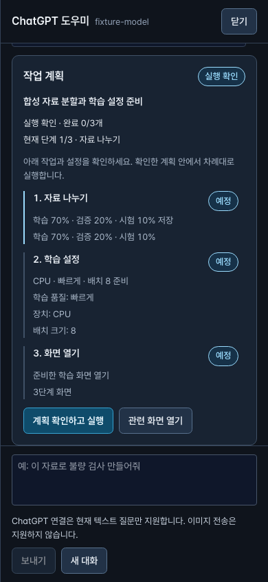

# 말로 작업을 맡기는 도우미

앱이나 이 컴퓨터의 localhost 웹에서 도우미를 열어 작업을 맡길 수 있습니다. 하단의 **왜 그런가요? → 도우미에게 묻기**로 열고, 처음에는 ChatGPT 연결과 모델 선택을 직접 완료하세요.

1. 원하는 일을 적습니다. 예: “이 자료를 학습70%, 검증20%, 시험10%로 나누고 빠른 학습을 준비해줘.”
2. 도우미가 제안한 **작업 계획과 입력값**을 읽고 **계획 확인하고 실행**을 누릅니다. 폴더 선택 창이 뜨면 사용할 폴더를 직접 고릅니다.
3. 카드에서 현재 단계와 저장 결과를 확인합니다. **작업 일시정지**는 다음 도우미 작업을 멈춥니다. 이미 시작한 학습은 계속되며, 학습을 중단하려면3단계의 중단 기능을 사용합니다.
4. 사람 검토가 필요하면 **검토 화면 열기**로 확인하고 **검토 결과 확인하고 이어하기**를 누릅니다. 라벨 채택·정답 확정·최종 모델/흐름 승인과 배포는 도우미가 대신하지 않습니다.

새로고침 뒤에는 로그인과 기존 ChatGPT 계정·모델 선택을 다시 확인하세요. 도우미는 저장된 작업을 읽으며 완료한 작업을 자동으로 다시 실행하지 않습니다. 학습의 임시 장치·배치 입력만 초기화됐다면 **저장 설정 복원**이 표시됩니다. 이 버튼은 표시된 입력만 복원하고 학습을 시작하지 않습니다. 이어가기는 그 다음에 별도로 확인합니다.

프로젝트·원본 자료·실행 서버·계정이 달라졌거나 직접 다른 설정을 입력했다면 저장 설정을 덮어쓰지 않습니다. 원래 작업을 다시 열어 확인하거나 현재 상태에 맞는 새 계획을 요청하세요. 응답이 끊겼다면 먼저 **저장 결과 확인**을 사용합니다. 오류만 보고 학습이나 평가를 다시 시작하지 마세요.

도우미는 프로젝트 준비, 자료 가져오기·분할, 지원되는 라벨 초안과 학습, 모델·저장 흐름 평가, 시험 검사, 보고서 저장, 화면 이동을 수행합니다. 필요한 자료·모델이 없거나 지원하지 않는 작업이면 이유와 확인할 화면을 보여 줍니다. 사용자가 검토하기 전 초안은 정답이 아닙니다.

현재 새 작업 실행은 macOS/Linux에서 지원합니다. Windows 작업 실행은 준비 중입니다. localhost 웹에서는 기존 네이티브 기능 사용 허용과 폴더 선택이 필요할 수 있습니다. ChatGPT에는 텍스트와 구조화된 앱 상태만 제공하며 원본 이미지·화면 캡처는 전송하지 않습니다.

검증한 범위와 제한: [작업 도우미 검증 기록](verification/2026-10-27-task-performing-assistant.md).
