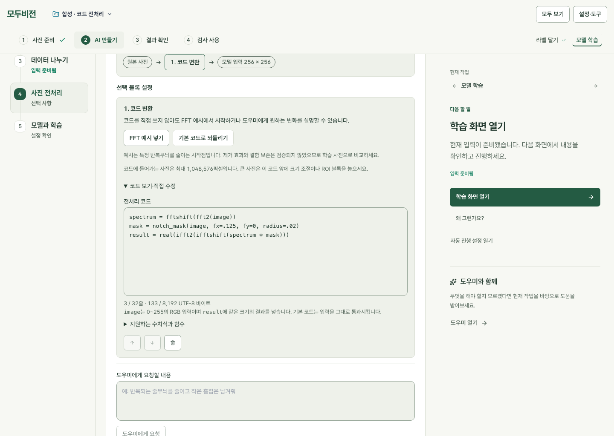
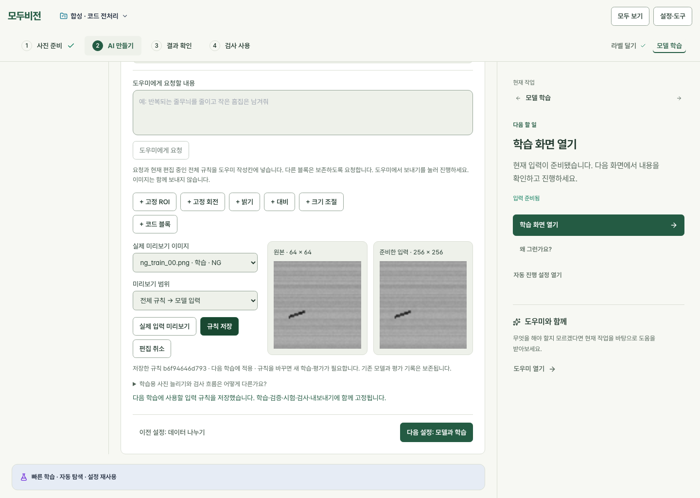

# 코드로 사진 전처리하기



합성 자료를 사용한 개발 화면입니다. 실제 초음파 품질을 검증한 화면이 아닙니다.

`AI 만들기 → 사진 전처리`에서 **+ 코드 블록**을 추가합니다. 분류·영역
분할에서 사용할 수 있습니다. 원본 파일과 정답 마스크를 덮어쓰지 않습니다.

코드를 몰라도 **도우미에게 요청할 내용**에 원하는 처리를 적고 **도우미에게
요청**을 누를 수 있습니다. 예를 들면 “초음파 사진의 세로 반복 패턴을 FFT로
줄이는 전처리를 만들어줘”라고 적습니다. 도우미 작성창에 요청문이 들어가며,
기존 ChatGPT 연결에서 **보내기**를 눌러야 질문을 전송합니다. 이미지는 자동으로
첨부하지 않습니다. 요청문을 넣는 것만으로 처리나 학습이 실행되지 않습니다.

도우미는 `read_input_preparation_contract`로 지원 문법을 읽고
`configure_input_recipe` 작업으로 실제 로컬 이미지 미리보기와 해시를 확인한 뒤
규칙을 저장할 수 있습니다. 도우미 작업 기록에서 실제 저장 결과를 확인하세요.
미리보기 성공은 노이즈 제거 품질이나 결함 보존을 승인한 결과가 아닙니다.
현재 편집기에 미저장 내용이 있으면 보존하고 저장 규칙과 충돌을 안내합니다.
도우미가 저장한 규칙을 불러온 뒤 편집기에서 원본/변환 결과를 비교할 수 있습니다.

직접 편집하려면 **코드 보기·직접 수정**을 펼칩니다. 최소 코드는 다음과 같습니다.

```python
result = image
```

`image`는 RGB 순서의 실수 배열이고 값의 범위는 0~255입니다. `result`에
동일한 가로·세로·색상 채널을 가진 결과를 넣습니다. 밝기나 대비를 바꾸는
예시는 다음과 같습니다.

```python
result = clip((image - 127.5) * 1.2 + 127.5, 0, 255)
```

**FFT 예시 넣기**는 반복 무늬의 특정 주파수를 줄이는 시작 코드를 넣습니다.

```python
spectrum = fftshift(fft2(image))
mask = notch_mask(image, fx=0.125, fy=0, radius=0.02)
result = real(ifft2(ifftshift(spectrum * mask)))
```

`fx`와 `fy`는 각각 가로·세로 방향의 cycles/pixel 주파수입니다. 예시의
`0.125`는 가로 8픽셀마다 반복되는 성분을 뜻합니다. `radius`는 줄일 주파수
범위입니다. 예시 값은 실제 초음파 자료에 맞춰 측정한 값이 아닙니다. 결함과
노이즈가 비슷한 주파수에 있으면 결함도 흐려질 수 있으므로 학습 사진으로
원본과 결과를 비교하세요. 검증·시험 사진에 맞춰 값을 튜닝하지 않습니다.

FFT는 이미지의 가로·세로 축에만 적용하며 RGB 채널을 섞지 않습니다.
`notch_mask`는 중심에 정렬한 스펙트럼에 곱하는 대칭 필터이며 DC 성분을
보존합니다. `fftshift`를 원본 이미지에 직접 적용하는 공간 이동은 거절합니다.
이 구현은 [NumPy FFT](https://numpy.org/doc/stable/reference/generated/numpy.fft.fft2.html)와
[주파수 정렬](https://numpy.org/doc/stable/reference/generated/numpy.fft.fftshift.html)을 사용합니다.

**실제 입력 미리보기 → 원본과 결과 비교 → 규칙 저장** 순서로 적용합니다.
코드를 고치면 이전 미리보기는 무효가 되므로 다시 확인해야 저장할 수 있습니다.
전체 규칙을 포함하지 않은 중간 블록 미리보기로 저장하지 않습니다. 저장된
코드·순서·해시는 모델에 결합되어 학습·평가·검사와 내보낸 검사기에서 같은
실행 경로를 사용합니다. 이전 모델의 전처리는 바뀌지 않습니다.



## 문법과 제한

Python의 대입·수식 문법 일부를 해석하는 `modu-numeric-v1` 언어입니다.
일반 Python 환경이 아니므로 `import numpy`, 외부 패키지, 파일·네트워크 접근,
객체 속성, 반복문, 함수 정의 등은 사용할 수 없습니다. 지원하는 함수는 다음과
같습니다.

| 함수 | 용도 |
| --- | --- |
| `fft2`, `ifft2` | 공간 영상과 주파수 스펙트럼 변환 |
| `fftshift`, `ifftshift` | 스펙트럼 중심 정렬과 복원 |
| `notch_mask(image, fx, fy, radius)` | 대칭 주파수 필터 |
| `abs`, `real`, `sqrt`, `log`, `exp` | 수치 변환 |
| `clip(value, low, high)` | 값 범위 제한 |
| `minimum(a, b)`, `maximum(a, b)`, `where(condition, a, b)` | 값 비교와 조건 선택 |

코드는 최대 8192 UTF-8 바이트·32줄입니다. 한 코드 블록에 들어오는 영상은
최대 1,048,576픽셀이며, 큰 영상은 **크기 조절**이나 **고정 ROI** 블록을 코드
앞에 배치합니다. 연산·변수·메모리와 FFT 횟수에도 제한이 있습니다. 지원하지
않는 문법, 잘못된 결과 크기, 무한대·NaN은 원본을 바꾸지 않고 오류로 알립니다.
CPU/라이브러리 호출의 실시간 제한을 보장하는 운영체제 샌드박스는 아닙니다.

학습 전용 무작위 증강은 별도 설정이며 코드에 난수를 제공하지 않습니다.
검출·OCR·이상 탐지 등 다른 모델군과 실제 초음파 현장 품질은 이 기능의
실행 검증만으로 지원·성능이 확인되는 것이 아닙니다.
