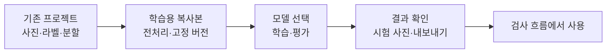

# 학습 작업대: 데이터부터 모델 사용까지

이 문서는 `feat/full-training-platform-20261116`의 통합 작업대를 설명합니다. 설치된 앱과 웹의 버전은 별도로 확인합니다. 개발 브랜치의 구현과 배포 완료를 같은 의미로 쓰지 않습니다.

프로젝트를 연 뒤 **AI 만들기 → 학습 화면 → 학습 작업대 열기**를 누릅니다. 상단 **더 보기 → 학습 작업대 · 데이터부터 모델까지**에서도 열 수 있습니다. 앱과 localhost 웹 모두 현재 로그인과 현재 프로젝트를 사용합니다. 새 Geti 계정이나 프로젝트를 따로 만들 필요가 없습니다.

## 화면에 보이는 다음 행동을 따라가기

1. **사진과 라벨 준비.** 기존 사진·라벨 화면에서 데이터를 준비합니다. 학습·검증·시험 이미지가 모두 있어야 합니다. 검증과 시험 사진을 학습에 섞어 부족한 자료를 채우지 않습니다.
2. **입력 전처리 저장.** 기존 학습 화면에서 밝기·크기·숫자식 코드·FFT 규칙을 저장합니다. 지원되는 작업에서만 같은 규칙을 학습과 추론에 적용합니다. 현재 프로젝트·라벨 세트의 규칙만 가져옵니다.
3. **학습 환경 시작 → 학습용 데이터 준비.** 원본과 라벨을 유지한 채 버전을 고정하고 Geti에 복사합니다. 사진 바이트, 클래스, 학습·검증·시험 구성원을 다시 읽어 확인합니다. 복사 뒤 원본·클래스·분할이 바뀌면 다시 준비해야 합니다.
4. **모델 가중치 준비 → 학습 시작.** 지원 모델을 고르고 학습 횟수를 입력합니다. 가중치 준비에는 모델에 따라 다운로드가 필요하며, 라이선스 동의가 필요한 모델을 자동으로 동의하거나 실행하지 않습니다. 이 통합의 첫 CPU 검증 모델은 EfficientNet-B0입니다.
5. **결과 확인.** 저장된 모델의 평가 분할·지표와 원본 좌표로 환산한 예측을 확인합니다. OpenVINO·ONNX는 실제 CPU 추론 경로를 사용합니다. PyTorch 파일은 내보내기용으로 구분하며 기존 모델 로더에 억지로 넣지 않습니다.
6. **검사 흐름에서 사용.** 검증한 모델·변형과 전처리를 고정해 검사 흐름에서 사용합니다. 원격 실행·독립 실행 파일처럼 아직 해당 형식을 받지 않는 경로는 명시적으로 거절합니다.

## 저장한 모델을 다시 열기

같은 계정과 프로젝트를 선택하면 저장된 학습 기록과 모델을 다시 확인할 수 있습니다. **고정된 학습·예측 규칙**은 모델을 만들 때 쓴 전처리입니다. 새 브라우저에서 편집 규칙이 비어 있거나 새 규칙을 작성해도 기존 모델의 예측 기준은 바뀌지 않습니다.

**확인할 사진 불러오기 → 확인할 사진 → 선택 사진 예측** 순서로 시험합니다. 고정된 사진은 저장된 식별자와 해시를 대조하며, **새 검사 사진**은 현재 프로젝트에서 허용한 입력입니다. 새 사진을 예측해도 이전 학습 묶음에 추가하지 않습니다. 검증된 Library revision이 없는 기존 폴더 프로젝트에서도 이 목록을 사용할 수 있습니다.

**선택 모델 내보내기** 뒤에는 브라우저 다운로드 목록과 실제 ZIP 저장을 확인합니다. 로그인과 프로젝트 권한은 목록·예측·파일 다운로드마다 적용됩니다.

## 도우미와 CLI에서 상태 읽기

공통 CLI의 기능 목록과 `describe`에서 `/api/platform/geti`의 실제 입력·결과 계약을 확인할 수 있습니다. 도우미는 현재 계정·프로젝트의 **학습 환경·작업 상태·모델 기록**을 읽으며, 이 상태 조회가 학습 환경을 시작하거나 학습을 다시 제출하지 않습니다. 도우미에 보내는 진단은 기존 경로·계정·자격증명 가림 규칙을 따릅니다. 기능을 발견했다는 것만으로 새 실행 권한이 생기지는 않습니다.

## 기존 작업과 자료는 어떻게 되나요?

- 현재 모두비전의 열 개 모델군과 기존 학습·원격 도구를 유지합니다. Geti 경로는 사진 분류·객체 검출·개체별 영역 분할을 지원합니다. 시맨틱 영역 분할을 개체 분할로 바꾸지 않습니다.
- 기존 영역 분할 프로젝트는 기본적으로 원래 학습 경로를 엽니다. Geti에서 개체별로 학습하려면 **개체별 영역 분할**을 직접 선택해야 하며, 개체마다 다각형 라벨이 있어야 합니다. 브러시·픽셀 마스크만 있는 자료는 변환하지 않습니다. 이 경로에서 아직 지원하지 않는 전처리 규칙도 명시적으로 표시합니다.
- 원본 이미지, 확정 라벨, 저장 분할과 기존 모델 파일은 복사 과정에서 덮어쓰지 않습니다.
- 가져온 라벨은 **새 라벨 세트와 새 데이터 버전**으로 저장합니다. **채택한 라벨로 라벨 화면 열기**를 눌러 사용할 세트를 선택합니다. 이전 세트는 남습니다.
- 앱과 웹의 기존 저장 공간은 각각 유지합니다. 이 기능 때문에 두 계정 저장소나 프로젝트 폴더를 자동으로 합치지 않습니다.
- 프로젝트를 바꾸거나 로그아웃하면 이전 프로젝트의 요청·화면 상태를 재사용하지 않습니다. 다른 프로젝트의 모델 UUID만 알아도 접근할 수 없습니다.

## 연결이 끊기거나 작업이 멈춘 것처럼 보일 때

**상태 새로 확인**으로 저장 기록을 읽으세요. 학습 요청의 응답이 사라져도 같은 작업을 자동 제출하지 않습니다. 이전 제출 결과가 불명확하면 새 학습을 중복 시작하지 않고 해당 기록을 표시합니다. 취소 요청과 실제 작업자 종료도 따로 표시합니다.

실행 환경이 없으면 설치 안내를 표시하며 기존 학습 도구는 계속 사용할 수 있습니다. 개발 실행에는 별도 Python 3.14 런타임이 필요합니다. 기존 Python 3.13이나 React 환경을 전체 업그레이드하지 않습니다.

이전 작업의 제출 결과가 불명확한 채 남으면 **실행 환경 종료하고 작업 상태 정리**를 사용합니다. 현재 프로젝트에 속한 실행기와 작업자가 실제로 종료됐는지 확인한 뒤 옛 기록을 중단 상태로 보존합니다. 기존 학습을 성공으로 바꾸거나 재제출하지 않습니다. 종료를 확인할 수 없으면 그 이유를 표시합니다.

## 검증 범위

합성 데이터의 실행·복사·학습·평가·모델 저장·재접속 검증과 실제 현장 정확도, 처음 쓰는 사람의 완주, 모든 운영체제의 배포 검증은 별개입니다. 최신 근거와 아직 남은 검증은 [통합 검증 기록](verification/2026-11-16-full-training-platform.md)에 기록합니다.

macOS 관리 데몬의 강제 종료 복구 소유권 추가 검사는 원래 실행에서 14건 통과·1건 실패를 보존했습니다. 별도 격리 재시도 1건은 통과했지만 원래 실패의 원인이나 수정 효과를 입증하지 않습니다. 이 제한은 관리 데몬의 소유권 확인 범위이며, 학습 작업대와 실제 모델 추론은 각자의 보존된 영수증으로 확인합니다. 자동 관리 업데이트는 여전히 미검증이며, 소유권·종료가 불확실하면 거절하는 보호를 유지합니다.
