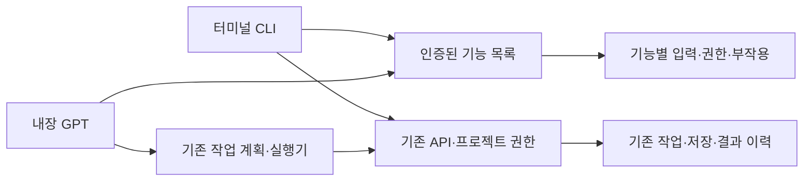

# 모두비전 공통 CLI

앱·웹 백엔드가 제공하는 프로젝트, 데이터, 라벨, 학습, 평가, 검사 흐름, 검사 실행, 보고서, 작업 이력과 원격 계산 기능을 같은 HTTP 계약으로 사용합니다. 기능 목록과 입력 형식은 **실행 중인 서버**에서 읽습니다. 학습 엔진을 따로 실행하는 기존 [`backend.training_cli`](training-engine-cli-rest.md)와는 별도입니다.



CLI 설치본이 서버를 시작하거나 앱의 미저장 편집을 조작하지는 않습니다. 먼저 해당 수정본의 `npm run dev` 또는 `npm run web` 서버를 실행합니다. 구버전 서버의 `404` 응답은 이 기능 목록이 없는 버전이라는 뜻입니다.

## 시작과 로그인

저장소에서 `python -m backend.studio_cli --help` 또는 `npm run --silent cli -- --help`로 실행합니다. Python은 표준 라이브러리만 사용하므로 CLI 도움말·접속을 위해 torch를 불러오지 않습니다. npm 명령은 웹 실행과 같은 Python 선택 규칙을 사용하며, `VISION_AI_PYTHON`으로 기존 인터프리터를 지정할 수 있습니다.

기존 로컬 계정으로 **터미널에 직접 로그인**할 수 있습니다. 아래의 인증서와 계정 이름은 자신의 서버에 맞춥니다. 자체 서명 인증서는 서버가 만든 **공개 인증서**를 명시적으로 신뢰하며, 개인 키는 전달하지 않습니다.

```sh
python -m backend.studio_cli \
  --url https://localhost:8443 \
  --ca-file "/absolute/localhost-cert.pem" \
  --session-file "/absolute/private-cli-session.json" \
  login --username your-local-user
```

비밀번호는 터미널에서 숨겨 입력합니다. 자동화는 `--password-stdin`을 명시해 한 줄을 전달할 수 있습니다. 비밀번호·토큰을 명령 인자나 대화에 적지 않습니다. 세션 파일은 새 파일에만 생성되고 POSIX에서는 `0600`입니다. 이후 같은 서버 URL에 `--session-file`을 지정해 재사용합니다. 다른 서버로 이 세션을 보내지 않으며 만료 시 새 경로에 다시 로그인합니다. 기존 앱의 인증 파일은 검색하지 않습니다.

이미 개발용 프로세스 권한을 전달받은 경우 `VISION_AI_STUDIO_API_TOKEN`, 공유 서버의 bearer를 전달받은 경우 `MODU_STUDIO_BEARER_TOKEN` 환경변수를 사용할 수 있습니다. 둘 다 있으면 `--auth desktop` 또는 `--auth bearer`로 하나를 고릅니다. 세션 파일과 환경 자격증명은 혼합하지 않습니다. HTTP는 loopback에만 허용하고 다른 호스트는 HTTPS를 사용합니다. TLS 검증 끄기와 자동 리다이렉트는 지원하지 않습니다.

이하 예시는 공통 접속 인자를 생략합니다. 실제 명령에서는 위의 `--url`, 인증서·세션 인자를 **하위 명령 앞에** 붙이세요. `MODU_STUDIO_URL`을 지정하면 URL 인자를 생략할 수 있습니다.

## 기능 찾기와 입력 확인

```sh
python -m backend.studio_cli capabilities --limit 1000
python -m backend.studio_cli capabilities --group "Dataset imports"
python -m backend.studio_cli describe "POST /api/training/start"
```

`next_offset`이 있으면 해당 값을 `--offset`으로 지정해 다음 페이지를 읽습니다. `describe`에는 경로·쿼리 인자, 요청 본문, 응답과 참조하는 schema가 포함됩니다. 명령 ID는 정확한 `METHOD /path` 문자열입니다. OpenAPI의 자동 이름과 달리 같은 경로의 여러 메서드도 구분합니다.

`effect: read`는 명시적으로 확인된 관측 목록에만 붙습니다. 다른 기능은 보수적으로 `execute`입니다. 특히 평가 결과·heatmap·보정의 일부 GET은 계산을 시작할 수 있고, `/api/project/current`는 기본 프로젝트를 선택·생성할 수 있습니다. **GET이라는 이유로 단순 조회라고 해석하지 마세요.**

## 1~6단계와 운영 기능

아래는 기능 위치입니다. 실제 요청은 먼저 `describe`로 현재 서버의 정확한 입력을 확인합니다. 표의 예시를 전부 실행해야 하는 순서는 아닙니다.

| 영역 | CLI 명령 ID 예시 | 입력·결과의 기준 |
| --- | --- | --- |
| 프로젝트 | `POST /api/project/create`, `POST /api/project/open`, `GET /api/project/labelsets` | 프로젝트 위치·유형을 명시. 공유 서버는 기존 계정의 프로젝트 선택 규칙 적용 |
| 1 데이터 | `POST /api/dataset/import`, `POST /api/dataset/split`, `/api/dataset/imports` | 서버가 읽을 경로 또는 업로드한 artifact; 원본·분할·버전 의미 유지 |
| 2 라벨 | `POST /api/annotations/save`, `GET /api/annotations/{image_id}`, `/api/label-suggestions/*`, 마스크·형식 교환 | 라벨 세트·수정 revision·lease·초안 채택 계약 유지 |
| 3 학습 | `POST /api/training/start`, `GET /api/training/jobs`, `POST /api/training/stop`, `/api/engine/*` | 모델·장치·원격 자원·예산을 기존 입력으로 지정. 작업 ID와 저장 모델 ID 구분 |
| 4 평가 | `GET /api/evaluation/results`, 평가 이력·비교 API | 현재 자료·정답·저장된 판정 기준과 연결된 평가. 요청 접수와 계산 완료 구분 |
| 5 흐름 | `POST /api/flowchart/pipeline`, `POST /api/flow-evaluations`, 흐름 초안·버전 API | 전체 graph·모델 결합·저장 버전·코호트 기준 유지 |
| 6 검사 | `POST /api/flowchart/run`, `/api/inspections/*` | 검사 recipe·큐·완료·검토·장비 ACK는 각각의 기존 계약 |
| 내보내기 | `POST /api/report/export`, `/api/export/*`, artifact content | 바이너리는 `--output`으로 새 파일에 저장 |
| 원격·운영 | `/api/compute/*`, `/api/product-delivery/*`, `/api/runtime-services/*`, 계정·보존 관리 API | 해당 서버의 역할·관리자·검토 권한 적용. 목록 노출 자체는 실행 권한이 아님 |

공유 서버에서는 `--project PROJECT_ID` 또는 `--context-json`의 `workspace_id`, `project_id`, `actor_id`, `mode`를 명시합니다. 응답의 `context`로 실제 범위를 확인합니다. `--project`와 context의 프로젝트가 다르면 CLI가 거절합니다.

```sh
python -m backend.studio_cli --project PROJECT_ID \
  call "POST /api/annotations/save" --body-file /absolute/annotation-request.json

python -m backend.studio_cli --project PROJECT_ID \
  call "GET /api/training/jobs"

python -m backend.studio_cli --project PROJECT_ID diagnostics --section jobs
```

`diagnostics`는 프로젝트·학습·작업 관측을 모으며 부분 실패를 각 항목에 남깁니다. 프로젝트를 암묵적으로 생성하지 않도록 `--project` 또는 `--context-json`이 필요합니다. 미저장 화면 상태·전체 과거 로그까지 읽었다는 의미는 아닙니다.

## 파일 전송

JSON은 `--body-json` 또는 `--body-file`, 경로·쿼리는 `--path-json`, `--query-json`으로 지정합니다. 추가 인자와 중복 JSON 키, NaN, 경로 순회는 거절합니다. 경로의 `/`는 서버가 실제 `path` converter로 등록한 인자에만 허용합니다. 파일의 서버 경로는 schema에 따라 query/body에 명시할 수 있습니다.

```sh
python -m backend.studio_cli --project PROJECT_ID \
  call "PUT /api/artifacts/uploads/{upload_id}" \
  --path-json '{"upload_id":"UPLOAD_ID"}' --query-json '{"offset":0}' \
  --upload-file /absolute/chunk.bin

python -m backend.studio_cli --project PROJECT_ID \
  call "GET /api/artifacts/{artifact_id}/content" \
  --path-json '{"artifact_id":"ARTIFACT_ID"}' \
  --query-json '{"revision":1,"sha256":"EXPECTED_SHA256"}' \
  --output /absolute/new-result.bin
```

업로드는 기존 begin→청크→complete 계약을 따릅니다. 청크는 기존 4MiB 상한 안에서 사용합니다. multipart를 선언한 기능은 `--file FIELD=PATH`와 `--form-json`을 사용합니다. raw·JSON·multipart 본문을 한 요청에 혼합하지 않습니다.

다운로드는 임시 파일에 스트리밍하고 `Content-Length`와 제공된 `X-Content-SHA256`을 확인합니다. 검증 뒤 새 파일로 게시하며 기존 파일을 덮어쓰지 않습니다. `server_checksum_verified:false`이면 서버가 SHA256을 주지 않았다는 뜻으로, CLI가 계산한 해시 자체와 구분합니다.

## JSON 결과와 실패 처리

stdout은 `StudioCLIResult/v1` 한 개입니다. npm으로 자동화할 때는 `--silent`를 쓰면 npm 안내 문구를 줄일 수 있습니다. `ok`, `http_status`, `outcome`, `result`, `context`, `observed_at`을 확인합니다. `result`는 기존 응답이며 실행 중 작업의 `queued`, `running`, `job_id`를 그대로 남깁니다.

| 종료 값 | 의미 |
| --- | --- |
| 0 | HTTP 응답을 처리함. 작업 완료·검사 OK·품질 승인을 뜻하지 않음 |
| 2 | 인자·인증 선택·세션 파일 등 요청 전 오류 |
| 4 | HTTP 거절·리다이렉트·응답 형식·다운로드 검증 오류 |
| 5 | 연결/응답 유실. 변경 작업은 `outcome: unconfirmed`일 수 있음 |
| 130 | 사용자 중단. 시작된 작업의 종료를 별도로 확인 |

모든 요청은 1회이며 자동 재시도하지 않습니다. 변경 요청 이후 응답이 없으면 같은 작업을 바로 다시 보내지 말고 기존 작업 소유 API의 상태를 확인합니다. 취소 요청 접수, worker 종료와 자원 해제도 구분합니다. 여러 엔진을 임의의 공통 `--wait` 규칙으로 판단하지 않습니다.

## 내장 GPT와의 연결

GPT는 `list_app_commands` → `describe_app_command`로 필요한 기능만 읽습니다. `read_app_command`는 별도로 고정한 관측 목록만 사용하고, 현재 프로젝트·자료·연결이 바뀌면 결과를 폐기합니다. 출력은 경로·계정·자격증명을 가리고 생략·부분 결과를 표시합니다.

`assistant.mode: task`와 `task_action`이 있는 기능은 기존 `read_app_features` → `propose_task` → 작업 실행기로 연결합니다. 따라서 실제 사용자 요청, 프로젝트 권한, 준비 조건과 작업 이력은 유지됩니다. CLI에 보이는 관리자·삭제·정답 승인·배포 명령이 GPT의 자동 실행 권한으로 바뀌지는 않습니다. 새 GPT 도구는 셸을 실행하지 않습니다.

OS 폴더 선택·보호 저장소·도우미 로그인·업데이트 등은 설치된 네이티브 호스트와 기존 동의가 필요합니다. 해당 서버에 설치됐을 때만 `transport: native`로 표시하며 bearer CLI는 `native_authority_required`를 반환합니다. 브라우저 쿠키·탭 승인을 가장하지 않습니다. 화면 이동·미저장 편집·마운트된 화면 전용 동작은 기존 앱 실행기의 기능으로 남습니다.

검증한 범위와 실제 실행 여부는 [CLI 검증 기록](verification/2026-11-14-studio-cli.md)에 별도로 기록합니다.
