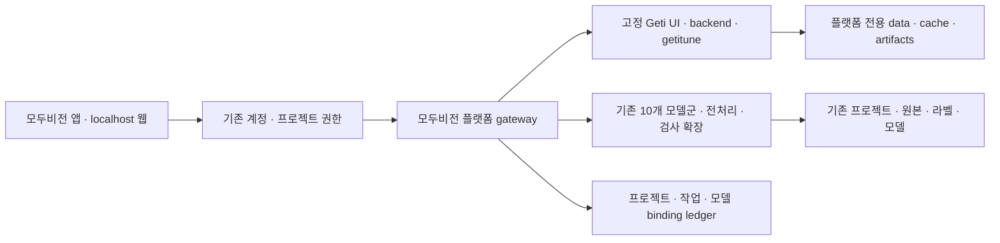

# 모두비전 전체 학습 플랫폼 기반 이식

## 목적과 결정

사용자는 라벨링 도구나 화면 몇 개의 모방이 아니라, 이미 만들어진 **전체 오픈소스 학습 플랫폼의 소스와 실행 구조**를 모두비전의 기반으로 활용하라고 요청했다. 데이터 관리·라벨링·학습·실험/모델 비교·평가·내보내기·추론을 하나의 사용 흐름으로 개선한다. 초보자는 모두비전 안에서 작업하며 외부 서비스 계정이나 별도 제품의 운영 절차를 배울 필요가 없어야 한다.

구현자의 선택은 **Geti application v3.3.0 전체와 같은 저장소의 getitune 학습 라이브러리를 고정 소스 의존성으로 가져오는 것**이다. 기준은 `open-edge-platform/geti`의 태그 `app/v3.3.0`, commit `ddcf394d550bf1b84ca262888260043af361f5e7`이다. SDK 하나나 일부 helper 함수를 가져오는 범위가 아니다. `platforms/geti/upstream`에 전체 저장소를 고정하고, 모두비전 소유의 연결·인증·저장·패키징 계층을 분리해 업스트림 개선을 추적한다.

작업 브랜치 `feat/full-training-platform-20261116`은 PR34의 `a92aea616d74d5b5195c876d3b01b5366242a224` 위에서 시작한다. PR34와 실행 중인 정확 head CI는 보존한다. 이 문서는 통합 목표이며 **소스 확보, 설치 가능성 시험, 실제 앱 통합, 설치본 배포는 각각 다른 완료 단계**다.

## 접근 방식과 선택 이유

| 접근 | 얻는 것 | 제약과 판단 |
| --- | --- | --- |
| **Geti 전체 application + library를 기반으로 통합** | 데이터/annotator/학습 작업/모델 revision/평가·export/추론의 연결된 소스 | 선택. 비전 플랫폼의 주요 동작과 화면을 함께 가져온다. Mac과 기존 모두비전 계약의 연결은 별도 구현·검증이 필요하다. |
| ClearML/MLflow 중심 통합 | 실험·artifact·registry·작업 추적 | 유용한 후보지만 전체 비전 데이터·라벨·모델 작업대를 대신 만들지는 못한다. 이번 주 기반으로 선택하지 않는다. |
| CVAT canvas + React Flow 등 개별 엔진 | 라벨 편집·그래프 상호작용 개선 | 보조 후보로 유지한다. 사용자가 수정한 전체 플랫폼 요구의 대체 완료물로 취급하지 않는다. |

Geti의 공개 저장소가 현재 제공하는 application task는 `classification`, `detection`, `instance_segmentation`이다. 이를 모두비전의 semantic segmentation과 이름만 바꿔 같은 정답으로 취급하지 않는다. 모두비전의 기존 10개 모델군과 전처리·검사 흐름·로컬 도우미는 확장 영역으로 유지한다. 새 기반의 지원 범위 밖인 OCR·회전 검출·각도 보정·이미지 개선·GAN·이상탐지 등의 사용 경로를 제거하지 않는다.

## 현재 소스와 연결 지점

| 영역 | 현재 모두비전 소유 계약 | Geti 측 실제 소스 경계 |
| --- | --- | --- |
| 프로젝트·접속 | `backend/contracts/context.py`, 로컬 웹 계정과 `hostAdapter.ts` | `application/backend/app/api/routers/projects.py`, UI `src/router.tsx` |
| 데이터·라벨·분할 | `routes_dataset_versions.py`, `training_provenance.py`, annotation/labelset·원본 fingerprint | `routers/media.py`, `datasets.py`, `dataset_revisions.py`, `dataset_views.py`, `dataset_ie.py` |
| 학습·작업 | `TrainingJobManager`, `local_training_worker.py`, `job_store.py`, remote coordinator; 독립 `training_engine.py` | `routers/jobs.py`, `training_configurations.py`, `app/core/jobs/`, `library/` |
| 평가·모델 | `evaluation_history.py`, 기존 checkpoint metadata/reconstruction, flow model catalog | `routers/models.py`, `model_architectures.py`, 모델별 training metrics와 revision |
| 추론·내보내기 | 기존 실행 recipe, exporter, 검사 흐름과 실제 service ACK | `routers/pipelines.py`, `sources.py`, `sinks.py`, `models.py`의 variant binary |
| CLI·GPT | 인증된 command catalog, `studio_cli.py`, 기존 typed task executor | 모두비전의 새 authenticated API adapter를 통해 노출. 임의 upstream API나 shell 권한을 모델에 추가하지 않음 |

## 소스·의존성·실행 격리

- 업스트림 전체 소스는 gitlink/submodule로 정확 commit에 고정한다. `upstream.lock.json`에는 저장소·tag·SHA·소유 application/library 경로와 읽은 license/notice를 기록한다. 수정은 모두비전 adapter 또는 명시적 patch queue에서 관리하고, 업스트림 gitlink 내부의 추적되지 않는 변경으로 숨기지 않는다.
- Geti core는 Apache-2.0이다. 번들/모델/가중치는 자체 notice가 있으므로 배포 manifest를 따로 만든다. upstream CPU extra가 선택적 Ultralytics까지 가져오는 점을 반영해 초기 기본 dependency profile에서는 해당 extra를 제외한다. 이미 모두비전에 있는 모델의 배포 조건과 새로 추가한 모델의 조건을 혼합하지 않는다.
- 현재 모두비전은 React 18.3.1/Python 3.13이다. 고정 Geti UI는 React 19.1.1, backend는 Python `>=3.14,<3.15`를 선언한다. 기존 `package-lock.json`, `.venv`, 전역 Node/Python을 덮어쓰지 않는다. Geti UI build와 Python 환경은 별도로 만든다. Node는 고정 UI의 `>=24.2.0`, npm은 `>=11.14.0` 요구를 확인한다.
- upstream의 제공 설치 경로는 Windows 앱/Linux Docker 중심이다. **macOS ARM CPU의 source build·학습·평가·export는 별도 가능성 검증 대상**이다. 설치 성공 또는 health 응답만으로 Mac 지원·전체 학습 성공을 선언하지 않는다. wheel 미제공·architecture·OpenVINO/torch incompatibility가 나오면 정확 오류와 재현 환경을 남긴다.
- 최초 시험은 소유 임시 data/log/cache root와 loopback의 별도 포트를 사용한다. 실행 앱·8443·GPU 작업을 바꾸지 않는다. 실제 설치 경로와 가용 용량을 확인하고 불필요한 모델 weight를 받지 않는다.
- telemetry/analytics와 모델 자동 다운로드를 초기 통합에서 비활성화한다. 존재하지 않는 환경변수를 설정한 것으로 완료하지 않고, 고정 source에서 시작·수집·송신 경로를 확인해 outbound 관측으로 증명한다. 학습할 모델은 명시한 로컬 weight만 사용한다. GPT/유료 호출·사용자 이미지 전송·새 계정 로그인은 이 가능성 시험에 포함하지 않는다.

## 목표 실행 구조

기존 모두비전의 supervised local process가 Geti child의 시작·포트·data root·종료를 소유한다. 고정 source 기본 `HOST=0.0.0.0`을 사용하지 않고 loopback으로 제한한다. 브라우저에는 인증된 모두비전 origin만 보인다. 포트 번호·child secret·경로를 renderer 컴포넌트에 하드코딩하지 않는다.

Geti upstream HTTP를 현재 웹 계정의 인증으로 오인하지 않는다. gateway는 현재 account/project/role을 검증하고, 서버 측 binding으로 upstream project/job/model ID를 결정한다. caller가 다른 upstream UUID나 임의 proxy path를 입력해 범위를 넓힐 수 없어야 한다. logout·account 전환·native consent 철회·stale request가 플랫폼에도 같은 효력을 가져야 한다. 최초 통합에서 upstream의 모든 endpoint를 무제한 reverse proxy하지 않는다.

Geti UI는 React 19 전용 build boundary로 둔다. 현재 React 18 renderer 내부에 소스 컴포넌트를 무작정 import하지 않는다. 초기 별도 원본 UI의 격리 실행은 가능성 시험일 뿐이다. 납품 UI에서는 모두비전 shell 안의 하나의 작업 경로와 인증·선택된 프로젝트·일관된 다음 행동을 제공해야 하며, 두 개의 서로 다른 프로젝트 목록을 사용자가 수동 동기화하지 않게 한다.

제품 통합 mount는 `/platform/geti/`, 인증된 API mount는 `/platform/geti/api/`로 계획한다. versioned UI patch는 `rsbuild.config.ts`의 asset prefix, `src/router.tsx`의 basename, `src/api/client.ts`·TUS upload·SSE의 API base와 서버가 반환한 media/download/Location URL을 함께 다룬다. 모든 rewritten media/job URL도 현재 프로젝트 binding을 검증한다. SSE는 cookie 기반 재인증·logout 시 종료를 검증하며 WebRTC offer/answer와 실제 media 경로도 별도 권한 범위다. child backend에는 supervisor가 생성한 instance secret을 검증하는 middleware patch를 넣고 gateway만 header로 전달한다. health도 secret 없이 열지 않는다. loopback이라는 이유로 upstream의 무인증 API를 브라우저에 노출하지 않으며 secret은 HTML/JS/URL로 보내지 않는다.

## 데이터·작업·모델의 binding

- `PlatformProjectBinding`은 모두비전 workspace/project/actor 권한 범위, platform instance root identity, Geti project UUID를 묶는다. 사용자 제공 외부 UUID만으로 로컬 자료를 읽지 않는다.
- `PlatformDatasetBinding`은 원본 manifest SHA, labelset, split/cohort SHA, source mapping, Geti dataset revision UUID와 파일 receipt를 묶는다. 검증된 snapshot에서 명시적 복사/변환 후 장수·클래스·geometry·mask·해시 readback을 대조한다. 원본 라벨·이미지와 기존 프로젝트를 제자리 migration하지 않는다.
- 학습에 실제 사용한 원본 ID→Geti media UUID와 `train`/`val`/`test` 구성원 목록을 각각 동결한다. hash만 저장하거나 upstream 자동 재분할을 그대로 허용하지 않는다. 요청한 구성원·공통 원본 그룹과 upstream dataset revision/subset readback이 정확히 같아야 학습을 시작한다.
- Geti에서 수정한 라벨은 작업 복사본이다. 모두비전으로 채택할 때 import 시작 시의 labelset/revision/source·split과 현재 상태를 비교하고, 기존 저장 API를 통해 **새 라벨 revision과 새 immutable dataset version**을 만든다. 이전 version을 제자리 수정하지 않는다. 그사이 모두비전에서도 수정됐다면 409 conflict로 멈추고 양쪽 변경을 보존해 비교·선택하도록 한다.
- classification 사진 정답, detection bbox, instance/semantic mask는 명시한 변환 행렬로 처리한다. 지원하지 않는 정답 타입은 변환을 거절하고 기존 확장 경로를 안내한다. 암묵적 class 생성·삭제·rename이나 기계 초안의 정답 채택을 하지 않는다.
- `PlatformJobLink`는 모두비전 job ID와 Geti job ID를 각각 저장한다. 실행 전 idempotency key를 예약하고, 응답 유실 때 기존 작업을 재조회한다. enqueue·진행·취소 의도·worker 종료·자원 해제·artifact publication을 구분한다. 재접속만으로 새 학습을 시작하지 않는다.
- 고정 upstream `POST /api/jobs`에 모두비전 idempotency가 이미 있다고 가정하지 않는다. upstream 작업 queue의 submission과 correlation 저장을 하나로 묶는 durable patch를 계획한다. 외부 요청 ID와 spec digest의 unique binding을 job publication 전에 저장하고 같은 요청 ID는 원래 job을 반환한다. 양쪽 DB 사이의 local reservation만으로 이중 제출이 방지됐다고 주장하지 않는다. 이 patch/재조회가 아직 없거나 결과를 특정할 수 없으면 `submission_unconfirmed`로 보존하고 **자동 재전송하지 않는다**. 현재 원본 `/api/jobs`의 메모리 이력만으로 재시작 후 durable recovery를 대체하지 않는다.
- `PlatformModelBinding`은 native model/revision/variant ID, checkpoint/export SHA, 사용한 데이터 revision과 평가 근거를 연결한다. Geti 모델을 기존 `model.pt` 재구성 코드로 바로 읽지 않는다. format별 inference/export adapter를 등록하고 실제 사진의 prediction까지 증명한다.
- validation model selection과 독립 test 평가는 구분한다. upstream 학습 metric이나 registry 등록을 현재 모두비전의 heldout 품질 승인·배포 승인으로 치환하지 않는다. 저장된 threshold·평가 코호트·labelset 변경은 기존 stale 검증에 반영한다.
- 외부 플랫폼의 보고 실패를 기존 학습 재실행으로 복구하지 않는다. 양쪽 durable binding과 관측 오류를 표시한다. 기존 모델군은 원래 ledger/loader를 계속 사용하며 플랫폼 통합 비교 화면에는 지원·미지원 상태를 정확하게 제시한다.

## 초보자 UI와 확장 기능

Geti의 연결된 데이터·모델·추론 작업대를 토대로 모두비전의 한국어 작업 shell을 구성한다. 기존 밝은 녹색 방향과 `DESIGN.md`/`UX-CONTRACT.md`를 유지하며, 한 번에 한 주요 행동을 제시한다. 작업에 맞는 데이터/라벨 준비, 학습 전 처리 블록, 모델 비교, 틀린 사진 수정, 검사 사용의 관계를 화면에서 읽을 수 있어야 한다.

전처리 블록·bounded code recipe·FFT, 현재 task별 모델 선택, 원격 계산, GPT의 현재 작업/오류 읽기와 명시적 실행은 확장 계층에서 유지한다. source import만으로 이 모든 기능이 Geti에 연결됐다고 표시하지 않는다. 기본 자동 진행은 준비된 작업을 이어가되 원본/정답/heldout 정책·실제 데이터 부재·자원/권한 오류를 성공으로 넘기지 않는다. 기술 ID는 근거 상세에 보존하고, 실패는 사용자가 할 다음 행동과 함께 표시한다.

## 순서와 완료 판정

| 단계 | 통과해야 할 증거 | 아직 뜻하지 않는 것 |
| --- | --- | --- |
| M0 전체 source 고정 | full application + library, 정확 gitlink SHA, license/notice/dependency manifest와 구조 확인 | runtime 실행·Mac 지원·모두비전 통합 |
| M1 실제 격리 runtime | UI/backend 실행, synthetic dataset upload/annotation/readback, 실제 CPU train→evaluation→variant export, 종료·재접속 | 기존 계정/프로젝트 통합·현장 모델 품질 |
| M2 인증·프로젝트 gateway | 계정 재로그인/전환·권한·다른 project ID·stale 응답·loopback·동시 요청 검증 | 기존 데이터 자동 migration |
| M3 기존 프로젝트·모델군 확장 | 명시적 copy/import receipt, 정확 클래스/라벨/split/해시, 10개군 기존 경로 보존, 실제 model format adapter | 지원하지 않은 변환/모든 OS 수락 |
| M4 모두비전 작업 UI | 데이터→준비 블록→학습→비교→평가 사진→검사 왕복, 한글·키보드·720px·양 theme·재접속·실패 복구 | 처음 사용자 완주·현장 수락 |
| M5 release | 정확 최종 head CI·독립 검토·실제 OS 패키지·기존 프로젝트 readback·매뉴얼/실행본 hash | 자동 운영배포·모델 품질 승인 |

현재 단계는 별도 진행 기록에서 실제 결과로 갱신한다. 실패한 가능성 시험, 원본 로그, 제외한 OS/모델·실데이터·사람 수락은 보존한다. source 확보를 “전체 플랫폼 이식 완료”로 보고하지 않는다.

초기 가능성 시험에서 scheduler child 두 개가 graceful shutdown 제한 뒤 강제 종료되는 경로와 Mac PyAV/OpenCV의 Objective-C 중복 경고가 관찰됐다. 실제 학습 job은 아직 검증하지 않았다. worker의 bounded graceful shutdown/강제 종료와 자원 해제를 M1/M2에서 별도로 다루고, 단순 project CRUD·UI build·재접속 성공으로 이를 완료 처리하지 않는다.

## 고정 공식 근거

- [전체 application/library와 지원 작업](https://github.com/open-edge-platform/geti/blob/ddcf394d550bf1b84ca262888260043af361f5e7/README.md)
- [core Apache-2.0](https://github.com/open-edge-platform/geti/blob/ddcf394d550bf1b84ca262888260043af361f5e7/LICENSE), [third-party notices](https://github.com/open-edge-platform/geti/blob/ddcf394d550bf1b84ca262888260043af361f5e7/THIRD-PARTY-NOTICES.md)
- [설치 대상·요구량·AGPL model 제외](https://github.com/open-edge-platform/geti/blob/ddcf394d550bf1b84ca262888260043af361f5e7/application/docs/install.md)
- [backend Python/CPU extra/library 경계](https://github.com/open-edge-platform/geti/blob/ddcf394d550bf1b84ca262888260043af361f5e7/application/backend/pyproject.toml)
- [UI React/Node/npm 요구](https://github.com/open-edge-platform/geti/blob/ddcf394d550bf1b84ca262888260043af361f5e7/application/ui/package.json)
- [runtime settings](https://github.com/open-edge-platform/geti/blob/ddcf394d550bf1b84ca262888260043af361f5e7/application/backend/app/settings.py), [프로젝트/작업/모델 API](https://github.com/open-edge-platform/geti/tree/ddcf394d550bf1b84ca262888260043af361f5e7/application/backend/app/api/routers)
