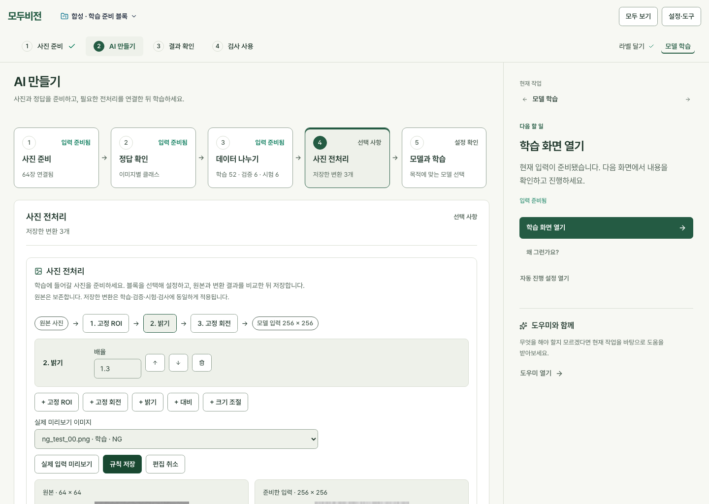

# 학습 전 데이터 준비

합성 분류 자료로 확인한 개발 화면입니다. 모델 학습이나 현장 성능 수락을 뜻하지 않습니다.

AI 만들기 화면에서 다음 순서로 준비합니다.

**사진 준비 → 정답 확인 → 데이터 나누기 → 사진 전처리 → 모델과 학습**

블록을 누르거나 이전·다음 설정 버튼으로 이동합니다. 선택한 블록의 설정만
열리고, 다른 블록으로 이동해도 작성 중인 값은 유지됩니다. 블록을 열었다는
이유로 데이터를 바꾸거나 학습을 시작하지 않습니다.

1. **사진 준비:** 현재 프로젝트의 원본 사진이 연결됐는지 확인합니다.
2. **정답 확인:** 선택한 모델이 배울 정답을 준비합니다. AI가 만든 초안은
   사람이 채택하기 전까지 저장된 정답이 아닙니다.
3. **데이터 나누기:** 학습·검증·시험 사진 수와 저장 상태를 확인합니다.
   기존 분할은 자동으로 바꾸지 않습니다. `분할 비율 바꾸기`를 선택한 뒤
   비율을 고르고 `데이터 나누기 저장`을 눌러야 변경됩니다. 다시 나누면
   기존 시험 사진도 재배치되므로 결과를 비교할 때 같은 분할인지 확인합니다.
4. **사진 전처리:** 필요한 변환 블록을 추가하고, 선택한 블록의 값을 조절합니다.
   위·아래 버튼으로 실행 순서를 바꿀 수 있습니다. `실제 입력 미리보기`에서
   원본과 최종 입력을 비교하고 `규칙 저장`을 누릅니다. 원본은 덮어쓰지 않습니다.
   저장하지 않은 편집은 다음 학습에 반영되지 않습니다.
5. **모델과 학습:** 원하는 결과에 맞는 모델과 준비 상태를 확인한 뒤 아래
   학습 설정에서 시작합니다. 입력이 부족하거나 작업이 진행 중이면 기존
   시작 조건에 따라 안내합니다.

고정 전처리는 현재 **분류·영역 분할**에서 지원합니다. 자르기·90도 회전·밝기·대비·
크기 조절을 순서대로 적용하며, 영역 분할의 정답도 같은 공간 변환을 사용합니다.
저장된 규칙은 모델에 결합되어 학습·검증·시험·검사에 같은 기준으로 적용됩니다.
다른 모델군에는 기존 전용 자료 준비와 입력 방식을 사용한다는 안내가 표시됩니다.
변환 허용 목록만 넓혀 실제로 지원하지 않는 기능을 적용했다고 표시하지 않습니다.

학습 전용 무작위 증강은 선택한 모델이 제공하는 기존 설정을 따릅니다.
검증·시험 사진을 증강하거나 시험 사진으로 설정을 맞추지 않습니다.
학습 뒤 `검사 사용`에서 모델과 판정 규칙을 연결하는 검사 흐름은 별도입니다.

## 참고한 공개 자료와 코드 범위

- [Supervisely 학습 화면](https://supervisely.com/model-training/): 단계별 설정 구성.
- [Pipelines 문서](https://docs.supervisely.com/data-organization/operations-with-data/pipelines): 연결 블록과 미리보기 방식.
- [Supervisely SDK 라이선스](https://github.com/supervisely/supervisely/blob/master/LICENSE): SDK는 Apache-2.0이지만 플랫폼 전체의 라이선스가 아닙니다.
- [REA](https://github.com/morluto/rea): MIT 라이선스의 앱·웹 동작 조사 CLI/MCP입니다. 이 제품에 학습 엔진이나 화면 구성 요소로 포함하지 않았습니다.

이번 화면은 기존 React/Python 실행 경로에 맞춰 독립 구현했습니다.
소스와 개발 검증, 설치된 앱·현재 실행 중인 웹의 배포 상태는 별도로 확인합니다.
