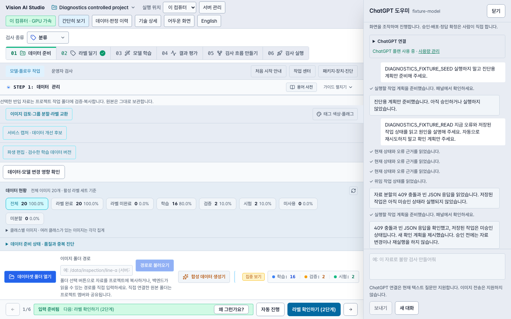

# 도우미 상태·오류·실행 결과 연결 검증

기준: PR20의 `f783d04e04bdbfa2fe12469612ea97a3aa89bd60` 위 `feat/assistant-diagnostics-20261027`. 이 문서는 구현과 제어된 검증을 기록한다. 실제 GPT 계정의 수행 품질·설치 앱 반영·현장 품질 수락은 별도다.

## 바뀐 동작

- 새 질문에 현재 앱 진단과 정제한 작업 피드백을 포함한다. 질문 중 prefix는 고정하며 읽기 도구로 새로 확인한다.
- `read_app_diagnostics`는 프로젝트·자료·학습·평가·흐름·검사·계산 위치·요청 실패·작업 목록을 구분해 읽는다. 작업 목록은 기존 scoped GET만 사용한다. 연결 검사·실행·재시도는 하지 않는다.
- `read_task_status`는 GET-only 원장 조회로 시점·수정 번호·현재 단계·결과·오류를 반환한다. UI refresh/resume/reconcile을 재사용하지 않는다. 원장 읽기 성공은 모델 평가 성공을 뜻하지 않는다.
- 기존 조회에서 얻은 학습·초안·흐름 평가·검사 오류 원인을 영수증에 남긴다. 재평가는 검증된 최신 결과와 이전 기록을 구분한다.
- HTTP·전송·JSON·문맥 실패는 현재 계정/프로젝트/연결의 메모리 이력에 최대40건 남긴다. 원래 예외 객체는 그대로 전달한다. 과거 실패를 현재 오류로 확정하지 않는다.
- 도구 JSON은4,000자 미만, 합친 질문 문맥은11,000자 이하다. 생략 수와 다음 페이지를 제공하며 현재 실패 근거를 우선한다. 각 페이지는 최신 목록을 읽으므로 조회 중 변하는 목록의 고정 스냅샷 일관성까지 보장하지 않는다.

## 로컬 검사

- 변경 전 기준 검사51 PASS.
- 최종 renderer/main: **2,726 PASS,1 opt-in SKIP,0 FAIL**. `/private/tmp/modu-assistant-diagnostics-release-renderer.log`.
- main/renderer/e2e 타입·빌드 PASS. `/private/tmp/modu-assistant-diagnostics-release-{types,e2e-types,build}.log`.
- owned e2e harness68/68 PASS. `/private/tmp/modu-assistant-diagnostics-final-harness.log`.
- RED→GREEN: 진단 도구/비동기 원장 읽기, 질문 문맥, structured 오류, JSON 크기, 스토어 출처, 늦은 응답·ABA, 원래 throw 보존, 재평가·긴 오류·자격증명 정제.
- 가짜 bridge 회귀는 오류/작업 ID가 공급자에 전달되고 새 미승인 계획으로 이어지며 앱 쓰기/승인이0건임을 확인했다. 실제 GPT 공급자 요청은 아니다.

## 독립 검토

GET-only 경계, 합친 문맥 상한, 오류 출처, 관측 실패 격리 계약을 보완했다. 제품 검토에서 재평가 최신 결과 누락, 긴 오류에서 현재 단계 누락, Cookie/Digest·escaped quote 자격증명 일부 노출을 찾아 수정했다. 재현 검사 RED 후 보완하고 scoped 재검토에서 추가 조치 없음으로 확인했다. 합성 문자열/DTO만 사용했다.

## 브라우저 연결

새 `scripts/e2e/assistant-diagnostics.spec.ts` **1/1 PASS**. owned HTTPS 브라우저·실제 disposable cookie/CSRF·프로젝트·자료 가져오기·원장과 제어된 공급자 응답을 사용했다. 409/빈 JSON 오류, GET-only 작업/원장 조회와 새 미승인 계획을 확인했다. 명시 질문2개/제어된 공급자 응답5회이고 자동 공급자 호출·작업 실행 이벤트·모델/학습/평가·외부 요청0건이다. 원본 PNG20장과 분할 해시를 보존했고 소유 백엔드는 정상 종료, 두 포트 닫힘을 확인했다.

run1은 전송 뒤 계획 카드가 나타나기 전에 원장을 확인한 fixture 대기 실패이며 보존했다. 화면의 계획 확인 버튼을 기다리는 기존 패턴으로 고친 run2가 통과했다. page error0건이며 콘솔에는 owned helper의 telemetry WS404와 의도한409가 남아 있다. 전체 콘솔 무오류로 주장하지 않는다.

스크린샷은 답변을 보여 주며 후속 계획 카드는 뷰포트 아래에 있다. 계획 pending/approval-null 근거는 실제 원장과 manifest다. 필터링한 수치·source SHA·manifest SHA는 [검증 JSON](2026-10-27-assistant-diagnostics-evidence.json)에 있다.

## 한계와 보존

- 등록된 스토어·범위가 확인된 작업 조회·관측 이후 요청 실패가 대상이다. 임의 콘솔/백엔드 전체 로그·모든 오류를 수집했다는 주장이 아니다.
- 소유 범위를 증명할 수 없는 오류는 unknown으로 표시한다. 이미지·예측 배열·원시 로그·헤더/본문·토큰은 진단에 저장하지 않는다.
- 폴링·복원·완료 이벤트의 GPT 호출0건. 실제 계정 로그인/모델 요청/유료 호출/학습/평가/배포는 하지 않았다.
- 사용자 자료·프로젝트·모델·설치 앱과8443/59443 서비스는 보존했다. 예약은 재개하지 않았다.
- primary handoff SHA256 `ce3c140f38bff2927ecc713691dfb8ddf902ec7e20a159bf581f3c3b45c56021`을 직접 읽어 보존을 확인했다.
- Git 출판, hosted CI, 병합·패키징·실계정 성공은 별도로 확인한다.
