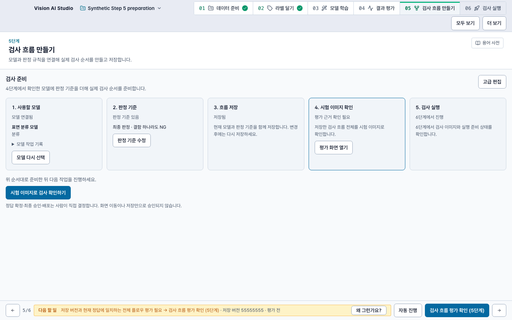

# Step 5 guided preparation verification

Scope: UI preparation over the existing flow editor; stacked on task-assistant PR19 e6f5fa5e. Existing save/recipe/adoption/evaluation/truth/approval handlers remain canonical. No backend behavior or model/provider API was changed. The installed app and real localhost8443/59443 services were not updated/restarted.

## Local results

- Renderer/main suite: **2,649 PASS / 1 explicit opt-in SKIP**, zero failures; log `/private/tmp/modu-step5-renderer-final.log`.
- Main/renderer/e2e typechecks and final build pass. Existing Vite >500kB chunk warning remains.
- E2E harness: **67 PASS**. CI structure: **29 PASS**. Service-plan and action-evidence integrity gates pass. Only the current FlowchartStudio owner SHA declaration was refreshed; historical GUI receipts, spec source identities and scenario records are unchanged.
- New behavior coverage includes earliest prerequisite, edited/stale saved evaluation, actual Studio advanced roundtrip and retired project callbacks, numeric score/count summaries, missing-model recipe preview, and access to unknown partial-run refresh/stop controls while preparation is locked. Tests were observed failing before the relevant implementations/fixes.
- Independent source review found three issues (running recovery reachability, missing optional recipe path, numeric criterion omission). All were fixed and scoped re-reviewed without remaining blockers.
- Four inherited expert-control browser regressions pass on the changed Studio: model-less exact draft reopen, existing-refusal preservation, node-limit preflights and readonly preflights. Their original assertions, deadlines, request/write counters and custody checks remain intact. Current Studio hashes and explicit ordinary full-view entry were updated; eight historical declaration rows update only current spec SHA/reason and retain original receipt/source/recorded SHA/retained commit. The historical service gate passes. These are current browser runs; they do not replace or relabel historical receipts.

## Owned UI run

`scripts/e2e/step5-guided-preparation.spec.ts`, browser run `step5-guided-preparation-20261027-review-5`: **1/1 PASS**, 6.3s test / 10.7s full run, retry0. This uses the actual final built renderer, real isolated project/import/backend and controlled flow/version/model-verification metadata. An intentional autosave503 proves unsaved edits survive guided→advanced→guided navigation. No real model weights or inference were used.

Confirmed: guided default, one preparation primary, evaluation prerequisite/explanation, four nodes/three edges and unsaved name/undo retained, keyboard view toggling, 390px dark/light preparation width390 with no horizontal overflow, original synthetic image hashes unchanged. Page errors0; external/provider/model/training/truth/deployment requests0. Owned backend and renderer proxy closed; backend PID dead and port closed.

The initial fixture/preflight runs remain preserved: missing FastAPI under default python, wrong full/simple toggle selector, and lexical `/var` versus canonical `/private/var` source expectation. No environment installs or app guards were changed to satisfy them. Console resource errors409/404 and the intentional503 are recorded; this is not a console-error-free claim. The legacy global footer remains crowded at390px.

Expert-control run1 failed initial exact path checks under macOS's lexical `/var` artifact root; physical `/private/tmp` retains those original checks. Run2 passed model-less reopen but the other three fixtures incorrectly clicked the simple-to-full toggle when the common harness had already selected full. Run3 uses an idempotent ordinary toggle and passes those three unchanged regressions. All failed logs/artifacts remain, and no running test was cancelled or edited in place. Successful manifests in the companion JSON confirm owned backend exit, closed port, no escaped process group and zero page errors.

The screenshot is synthetic, taken from the actual browser renderer; it is not evidence of a real model evaluation or installed Electron update. Original manifest/screenshot/source hashes are listed in the companion evidence JSON. Their pre-publication source identity remains base e6f5fa5e plus working-tree edits, not hosted exact-head CI.

## Remaining qualification

The deterministic UI static auditor reports121 findings both on base e6f5fa5e and the changed tree, with **zero newly introduced findings** (comparison `/private/tmp/modu-step5-ui-static-comparison.json`). Existing whole-application accessibility/design ownership findings remain; this change does not certify WCAG compliance.

Real model execution, GPT provider execution, human quality acceptance, installed Electron packaging, exact-head hosted full regression and main merge are separate and not claimed by these local results. No automation, auto-merge or deployment was enabled.
