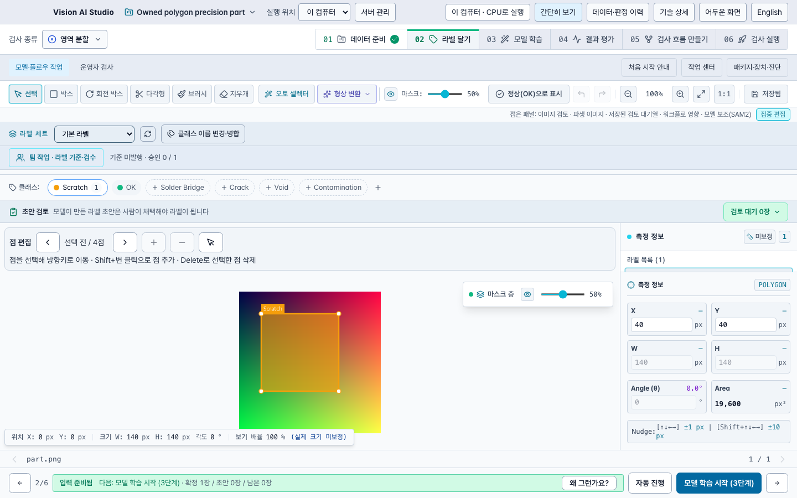

# 모두비전 폴리곤 정밀 편집 — 브랜치 검증

기준: main `080666112135e5fdb4bf69cf291c97dd809a2f38`에서 분리한
`feat/label-studio-precision-20261114`. Label Studio 전체 UI 이식이 아니라
기존 canvas에 선택한 순수 geometry 코드를 연결한 구현이다.

## 구현

- Shift+변 클릭과 선택 점 다음 변의 중간에 점 추가, 선택 점 삭제·방향키 이동.
- 점 선택과 전체 도형 선택을 구분하고 최소 3점·겹친 점·유효하지 않은 편집을 거절.
- 기존 undo/redo, 양쪽 geometry 별칭, bbox, ID·class·text·direction·origin 보존.
- 기존 store·save API·revision·edit lease·검수·mask 생성 계약을 유지.
- 처음 선택하는 drag 동안 새 controls를 지연하고, 다른 안내 줄의 reflow는
  시작 client 좌표·점·배율에 고정한 pointer delta로 처리.
- 마스크 controls를 실제 image viewport에 두어 새 controls와 겹치지 않음.
- Label Studio 고정 출처·수정 고지·Apache LICENSE/NOTICE를 보존하고
  Vite public→renderer 배포본에도 원문 bytes를 함께 제공.

## 직접 실행한 검증

로컬 도구: Node 26.4.0, Python 3.13.5, Playwright 1.63.0 및 소유 Chromium
fixture. 저장소 CI의 Node 24 결과와 별도이다.

| 검사 | 실제 결과 |
| --- | --- |
| 전체 renderer/main Node 시험 | 3,115 PASS / 1 SKIP / 0 FAIL (3,116개) |
| TypeScript 앱·main 및 E2E 타입 | 모두 통과 |
| production build | 통과. 기존 shared dynamic-import 및 bundle-size 경고 유지 |
| E2E harness | 69/69 통과 |
| 새 polygon browser | 4/4 통과 |
| 기존 bbox/polygon/OBB/vector browser | 1/1 통과 |
| service plan/action evidence 무결성 | 통과. 과거 records bytes 보존, 새 역사 수락 credit 0 |
| pinned source·LICENSE·NOTICE와 public 배포 고지 | SHA·함수 본문·배포 원문 동일성 통과 |
| UI strict 정적 감사 | 기존 base 38건, 현재 38건으로 동일; 신규 finding 0 |

새 browser 경로는 합성 256×256 이미지로 실제 화면의 좌표 편집,
1/10px nudge, Delete, undo/redo, GUI 저장·재열기·mask pixel, metadata 보존,
Tab/Enter controls, 최소 3점, 이미지 A→B→A, 760px 양쪽 theme 및 버튼
실제 hit-test를 확인했다. 별도 첫 선택 drag는 기존 draft 안내가 viewport를
이동하는 동안에도 `[40,40]→[50,40]`만 변경해 저장됨을 확인했다.

모든 fixture backend는 정상 종료됐으며 원본 이미지·모델/보고서 폴더를
보존했다. page/console/foreign/금지 실행 요청과 blocked-loopback 오류는 없었다.
학습·실제 모델 추론·외부 GPT 요청은 실행하지 않았다.

## 실패와 수정 이력

- 새 순수 geometry 16개와 Canvas 최초 5개 시험을 RED로 확인한 뒤 구현했다.
  기존 이미지 시험 19개는 새 typed import를 test loader가 찾지 못해 실패했다.
  실제 helper를 같은 플랫폼 인터페이스로 읽도록 loader만 확장했고 원 단언은 유지했다.
- 실제 store 시험에서 저장 mapper의 text 누락을 RED로 확인해 한 필드만 보강했다.
- 독립 리뷰가 첫 선택 controls의 mid-drag 좌표 점프를 발견했다.
  실제 component unit에서 `[20.5,90]`과 기대 `[20.5,130]`의 차이를 재현했다.
- 실제 browser에서 좁은 화면의 mask toolbar 가림과 전체 도형 선택 뒤
  비활성화된 버튼에서 focus가 빠져 Delete가 도형을 지우는 문제를 확인했다.
  위치 소유권·모드 버튼 focus를 수정하고 실제 hit-test/키보드 검증을 통과했다.
- draft 보존 안내의 별도 reflow는 추가 unit RED로 좌표 오류를 확인하고
  client-frame/pointer capture로 수정했다. 과거 browser의 rect 고정 실패를
  저장 좌표 오류의 직접 RED로 확대하지 않는다. 최종 browser는 reflow 원문과
  정확한 저장 좌표를 검증한다.
- 초기 E2E fixture 구조분해 형식과 grep 선택 실패는 제품 실패와 구분해 보존했다.

## 수락 경계

소스·합성 browser 검증이다. 현재 설치 앱·localhost 웹을 교체하거나 main을
병합하지 않았다. 실제 현장 라벨의 정확도·작업시간 개선, 모든 OS 설치,
공개 배포·공증, 전체 기능의 사람 수락은 이 기록에 포함되지 않는다.
원격 CI 결과는 PR의 정확한 head에서 별도로 읽는다.

