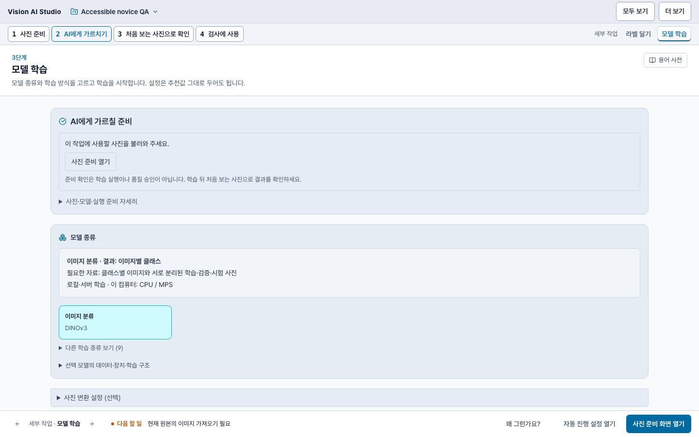
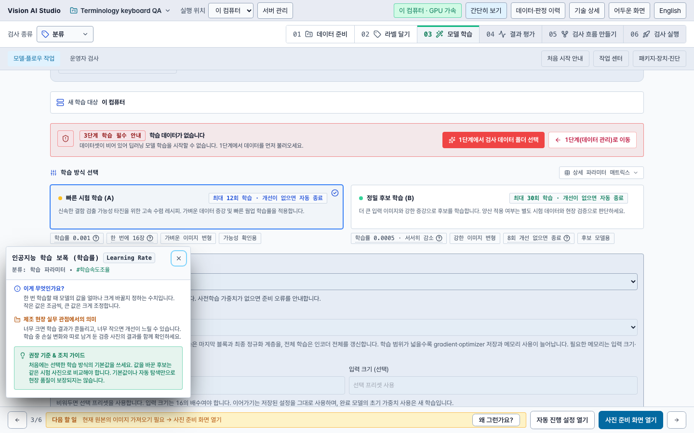

# 다중 모델 파일럿 후보 — 2026-11-14

이 후보는 초보자용 시작 흐름, 모델별 준비 안내, 폴리곤 정밀 편집, CLI와 내장 오픈소스 작업을 한 검토 브랜치에 합친 것입니다. 분류 하나로 범위를 줄이지 않았으며 **10개 모델 계열**을 유지합니다. 현재 상태는 **소스·자동 검사 기반의 파일럿 후보**입니다. 고객 현장 품질, 처음 사용하는 사람의 완주, 설치본 배포 승인을 뜻하지 않습니다.

## 사용자가 보게 되는 변화

- 사진에서 얻을 결과로 작업을 시작하고, 선택한 모델의 결과·필요한 자료·실행 위치를 먼저 확인합니다. 세부 실행 단계와 설정은 펼쳐 봅니다.
- 사진은 가져왔지만 검출·분할 정답이 없는 상태는 다시 가져오라고 하지 않고 라벨을 만들도록 안내합니다. 정답·클래스·분할 조건은 그대로 검사합니다.
- 프로젝트 창의 시작 포커스, Tab 순환, 닫은 뒤 원래 버튼 복귀를 통일했습니다. 하위 대화상자의 키보드 입력을 부모 창이 가로채지 않습니다.
- 용어 설명은 **Radix Popover**로 내장했습니다. Enter/Space로 열고 Escape로 닫으며 도움말 버튼으로 돌아옵니다. 실행 버튼을 누르거나 학습을 시작하지 않습니다.
- Label Studio 유래 정밀 폴리곤 편집을 통합했고, Mac의 동일 폴더가 `/var`와 `/private/var`로 표현될 때 라벨 읽기가 실패하는 문제를 고쳤습니다. 내부 링크의 라벨 이름과 외부 폴더 차단은 유지합니다.

두 그림은 격리된 검증 프로젝트 화면입니다. 실제 고객 자료나 학습 결과가 아닙니다.

## 확인한 근거

| 범위 | 이번 결과 | 해석 한계 |
| --- | --- | --- |
| 타입·빌드·실행 계약 | renderer/main/e2e 타입, Vite/main 빌드, provenance/evidence 검사, harness 70건·실행/복구 계약 82건 통과 | Host Node26.4.0/Python3.13.5. 원격 CI의 Node24/고정 환경은 별도 검증 |
| Renderer 회귀 | 3,229 passed, 0 failed, 2 skipped | 소스 동작 검사; 실제 사용자 완주와 다름 |
| UI 브라우저 | 시작 안내·목적 선택·모델 안내·도움말·프로젝트/하위 창 포커스 4건 통과 | 실제 renderer/격리 backend. 하위 창은 실제 React 컴포넌트 조합 fixture |
| 실제 도움말/부모 창 조합 | Radix·WorkspaceDialog 실제 컴포넌트 조합 1건 통과; 도움말만 닫기→부모 창 유지→trigger 복귀→부모 닫기 | 모의 컴포넌트 없이 검사, API 호출 0. 특정 실제 제품 경로의 관찰과는 구분 |
| 도움말 좁은 창·어두운 화면 | 1100×780 경계, 키보드 복귀, scoped axe A/AA 1건 통과 | 전체 제품 접근성 인증 아님 |
| 폴리곤 브라우저 | 점 삽입·이동·최소 점 수·실행 취소/재실행·저장·재열기·이미지 전환 4건 통과 | 원본 파일과 다른 이미지의 저장 내용 보존. 동일 소스 bundle의 폴리곤 코드 사용 |
| Native source 앱 | Electron 44.11.3 실제 시작·owned backend 정상 연결·창 닫기 2건 통과, 프로세스/포트 종료 확인 | [실행 증빙](receipts/2026-11-14-pilot-native-smoke.json). 설치본·동결 backend 검사와 다름 |
| 라벨 API | 별칭·쓰기·경계·형식·프로젝트 격리 26건 통과 | 신규 회귀 4 FAIL→수정 뒤 PASS, 이탈 링크 거절 유지. 독립 검토자 별칭 관련 7건 재확인 |
| 모델 실제 실행 | 회전 보정 source CLI, CPU 20/20 epochs, 합성 test 16장, MAE 1.851141° | [저장 결과와 해시](receipts/2026-11-14-pilot-cpu-rotation.json). GPU·외부 가중치·고객 사진 없음. 다른 모델·동결 앱 성능 근거 아님 |
| 독립 소스 검토 | UI/라벨 경계에 남은 중요 지적 없음 | 발견된 하위 portal Tab 문제는 수정 후 재검토. 전체 아키텍처·모델 품질 승인 아님 |

앞선 실패 로그는 덮어쓰지 않았습니다. 폴더 표기 API 오류와 별도로, 실제 저장 요청의 경로를 문자 그대로 비교하던 E2E fixture도 같은 실제 파일임을 검증하도록 고쳤습니다. 저장·revision·geometry·원본 보존 단언은 유지했습니다. 과거 service-action-evidence 기록은 변경하지 않고 실제 바뀐 소스 해시만 갱신했습니다.

## 오픈소스와 의존성

기존 Label Studio 유래 코드의 출처 검사를 유지하고, Radix Popover 1.3.1을 접근 가능한 용어 설명에 내장했습니다. axe-core/Playwright는 개발 검사 전용입니다. [원문 라이선스와 출처](../../public/third-party/radix-popover/SOURCE.md), [고지](../../THIRD_PARTY_NOTICES.md)를 포함합니다.

호환 범위 안에서 Electron 44.11.3, Vite 6.4.6 및 관련 의존성을 갱신했습니다. npm 감사의 영향 패키지 항목은 **16개(critical 2/high 6/moderate 8) → 6개(moderate)**입니다. 6개는 minimatch와 이를 사용하는 패키징 도구에 남아 있습니다. 감사 숫자를 줄이려고 builder를 하향하거나 검증하지 않은 major override를 적용하지 않았습니다. 개발 의존성의 Electron도 실제 배포 엔진이므로 무시하지 않았습니다.

## 배포 및 고객 검증의 남은 조건

1. **정확한 후보 commit의 원격 fast/full CI**: 결과를 별도 기록합니다. 로컬 검사로 전체 회귀 성공을 대신하지 않습니다.
2. **설치본 검증 미완료**: 격리 PyInstaller 컴파일은 끝났지만 동결 backend 진단이 기존 120초 상한에 걸려 실패했습니다. 시작·재시작 acceptance에 도달하지 못했으며, 이후 라벨 API 수정으로 source도 달라져 그 산출물은 최종 설치본이 아닙니다. 라이선스 원문 누락 8종은 공식 배포본과 고정된 upstream 출처로 확보했고, 재수집 결과 254 components / 315 files / missing 0입니다. 현재 소스와 해당 공급 자료를 사용한 최종 1회 빌드도 컴파일은 끝났으나 `--backend-diagnostics`의 동일한 120초 timeout이 재발했습니다. 시작·재시작 acceptance에는 도달하지 못했습니다. 45초 시점의 1초 sample은 Python import → macOS dyld의 라이브러리 매핑·서명 등록 → `__fcntl` 대기를 보여주며, 특정 라이브러리 또는 OS 원인까지 확정한 것은 아닙니다. 시간 제한·서명 정책을 바꾸거나 실패 후 반복 실행하지 않았습니다. 두 실패 산출물은 보존하며 **패키지 배포 준비는 실패/보류**입니다.
3. **설치본과 source 앱 구분**: 초기 native exit 2는 macOS `/var` 별칭인 검증 폴더가 기존 경로 보안 검사에서 거절된 원인이었습니다. 검증기가 선택한 기본 임시 경로만 정규화했고, 명시적 경로와 제품 가드는 유지했습니다. 이후 오래된 URL 단언을 실제 owned 파일과 `view=full`의 정확한 URL 검사로 고쳤습니다. 최종 source native 2건과 harness 18건은 통과했지만 설치본의 서명·배포 수락을 대신하지 않습니다.
4. **모델별 실제 검증**: [10계열 표](../pilot-model-matrix.md)에 source 계약·실행·현장 품질을 구분했습니다. 회전 보정의 한 합성 실행을 전 모델 검증으로 확대하지 않습니다.
5. **처음 사용자·현장 수락**: [파일럿 절차](../pilot-playbook.md)와 [빈 관찰 기록](../pilot-session-template.md)으로 수행해야 합니다. 사용 시간·도움 횟수·미검/과검을 실제로 관찰하기 전에는 판매 준비 완료라고 표시하지 않습니다.

현재 설치 앱, localhost 서비스, 실제 계정·원본 데이터와 원래 기능 브랜치는 교체하거나 삭제하지 않았습니다. 컴파일은 격리 산출물로 수행했습니다. 첫 PyInstaller 명령은 기본 사용자 compiler cache를 정리했고 이후 작업은 전용 cache 경로를 사용합니다. 보안 설정, 현장 배포, 서명 권한은 바꾸지 않았습니다.

## 재현과 기록

구체적인 명령은 [구현 계획](../superpowers/plans/2026-11-14-multimodel-pilot.md), 테스트는 `novice-accessibility.spec.ts`, `project-keyboard.spec.ts`, `labeling-polygon-precision.spec.ts`, `test_annotation_load_source_spelling.py`에 있습니다. 로컬 상세 로그·검토·빌드 원본은 `.superpowers/sdd/2026-11-14-multimodel-pilot/`에 보존합니다. 이 문서의 실행 결과를 다른 commit·다른 OS의 성공으로 재사용하지 않습니다.
