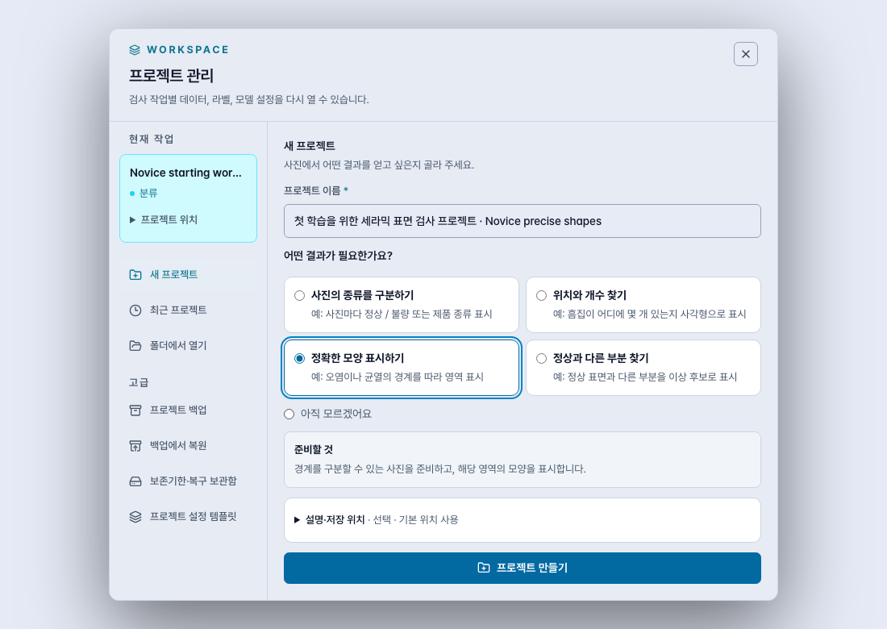
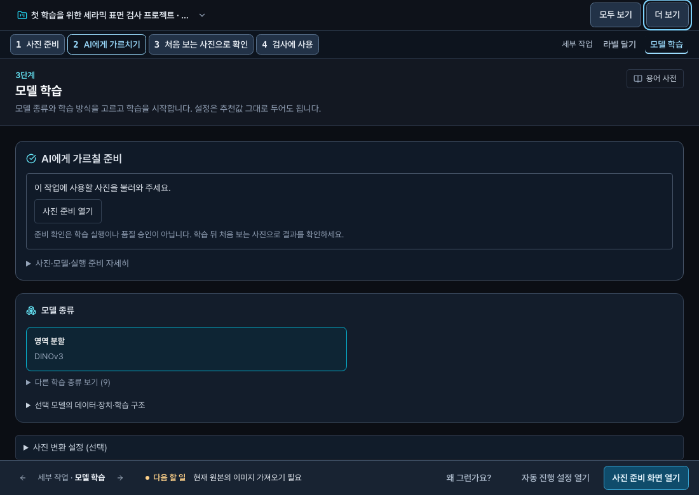

# 초보자 화면 UI·UX 정리

PR #29의 첫 구현 `81b61d4a` 뒤 같은 `feat/novice-first-20261114` 브랜치에서 화면을 다듬었다. 설치 앱·현재 웹 서버는 교체하지 않았다. 기존 사용자 데이터·실행기·프로젝트 전환·학습 시작 조건을 유지한다.

## 바뀐 동선과 화면

- 새 프로젝트의 목적 선택을 두 열로 배치하고, 선택한 목적의 준비 사항만 표시한다. 설명·저장 위치와 현재 프로젝트 경로는 펼쳐 볼 수 있다. 접어도 입력값은 유지한다.
- 간단히 보기의 첫 줄은 프로젝트·메뉴, 다음 줄은 네 가지 목표와 내부 작업이다. 좁아지면 상태 안내가 메뉴를 덮지 않도록 줄바꿈한다.
- 하단에는 현재 세부 작업 이름, 준비 상태, 강조된 다음 행동을 보여준다. 단순 입력 부족을 큰 오류 영역처럼 표현하지 않는다. 이전/다음·자세히·자동 진행은 조용한 보조 버튼이다.
- 사진과 현재 작업이 없으면 중복 진행 안내를 생략한다. 빈 폴더를 골랐다는 이유만으로 준비됐다고 표시하지 않는다. 실제 작업 기록은 사진이 없어져도 유지한다.
- 저장 실패 안내가 창 아래에 가려지면 해당 안내를 보이게 스크롤한다. 키보드 포커스·입력값을 유지하며 재실행은 사용자가 다시 누를 때만 한다.

## 실제 캡처

합성 QA 프로젝트, Chromium 1100×780. 실제 사용자 사진·학습 결과가 아니다.

## 검사 결과

| 검사 | 결과 |
| --- | --- |
| 전체 renderer | **3,190 pass / 0 fail / 2 opt-in skip**, 전체 3,192개 |
| renderer/main TypeScript 및 e2e TypeScript | 통과 |
| 격리 renderer production build + 실제 backend/Chromium | **1 pass**, fresh build |
| 독립 소스 검토 | 빈 원본 조건·좁은 헤더를 보완한 뒤 열린 지적 없음 |
| 디자인 정적 감사 | 기존 38건 → 32건, 새 위반 유형 없음. 전체 strict 검사는 아직 실패 |

Browser 시나리오는 미선택 생성 차단, 방향키 라디오 선택, 선택 설명, 접은 입력의 보존, 생성 요청의 합성 503 오류, 오류 전체 노출, 기존 프로젝트 보존, 명시적 재시도 후 실제 생성·task readback, 네 목표와 모두 보기 탐색을 포함한다. 1440×900·1100×780에서 만들기 버튼 전체 노출, 가로 넘침 없음, 밝은/어두운 학습 화면을 확인했다. 작은 전화기 화면 전체 지원이나 스크린리더 완주 검증은 주장하지 않는다.

디자인 감사의 남은 32건은 이번 변경 밖 기존 폼·textarea 규칙이다. 이번 프로젝트 관리 폼 5개는 기존 코드 검증 소유권을 `noValidate`로 명시했고 템플릿 textarea 크기 변경을 제한했다. 검사기를 우회하거나 기준을 낮추지 않았다. Renderer skip 두 건은 기존 opt-in bridge/ASGI 검사다.

## 발견·수정한 실패

1. 선택한 빈 폴더도 원클릭 시작 안내가 보이던 문제를 회귀 검사로 확인하고 실제 원본 사진 수를 보도록 수정했다. 실제 진행 기록은 이 조건으로 숨기지 않는다.
2. 1100×780에서 생성 오류 안내가 18.17%만 보였다. 오류가 생기면 가까운 위치로 스크롤하도록 수정했다. 첫 수정 후 경계의 소수 픽셀 때문에 99.75% 노출에 그쳐, 작은 스크롤 여백을 추가했다. 최종 검사는 전체 노출(비율 1)을 유지해 통과했다.
3. 이전 head `81b61d4a`의 원격 [fast run 43587110660](https://github.com/JaeHongChoe/modu-vision/actions/runs/43587110660)은 소스 증빙 해시 3개가 오래돼 정적 단계에서 실패했다. 해당 run의 renderer/build 단계는 실행되지 않았다. [현재 소스 연결 갱신 기록](2026-11-14-novice-action-source-delta.md)에 근거를 남기며 과거 수락·실행 영수증을 바꾸지 않는다.

로컬 로그·원본 실패 로그·독립 리뷰는 `.superpowers/sdd/2026-11-14-novice-ui-polish/`에 보존한다. 최종 UI 실행은 `2026-11-14T11-10-49-072Z-85245`, 로그는 `browser-recovery-final.log`다. 테스트 소스·제품 소스 해시는 `verified-source-sha256.json`에 보존한다.

이번 범위는 첫 사용 화면의 동선·정보 우선순위·오류 복구다. 원격 CI와 전체 회귀는 별도이며, 실제 모델/GPT 호출·사용자 데이터 작업·설치 교체·현장 품질 승인·초보자의 완주율을 이 결과로 대신하지 않는다.
