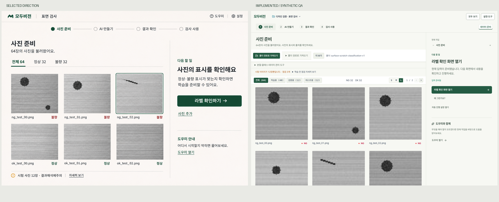

# 모두비전: 선택한 3번 디자인 구현 검증

검증일: 2026-11-15 KST. 브랜치: `refactor/novice-workspace-20261114`.
제품 기준: `6fefa39a203a1c5b51f49130d36caeaefaa9064c` (PR #30의 독립 출시 준비 작업 위에 쌓인 UI 변경).

사용자가 선택한 두 번째 시안 묶음의 3번을 기존 앱에 적용했다. 따뜻한 밝은 배경과 짙은 녹색, 사진 중심 작업 영역, 오른쪽 다음 행동 패널을 사용한다. 기존 여섯 단계는 네 가지 작업 목표로 묶어 표시하고, 모두 보기에서 여섯 단계를 직접 이동할 수 있다. 모델 10종, 저장·복구·취소·승인 경계와 편집기 수명은 유지한다.

## 변경 범위

| 영역 | 결과 |
| --- | --- |
| 공통 화면 | 중복 전역 안내를 정리하고 네 가지 작업 목표, 이름 있는 설정·도구 메뉴, 한 개의 다음 행동 패널을 구성했다. 언어/테마/프로젝트/계산 서버/용어 사전/도우미 접근을 유지한다. |
| 사진 준비 | 사진과 파일·클래스 표기를 중심에 두고 분할·클래스·데이터 관리 기능은 접어서 열도록 했다. 불러오기·경로 입력·오류·중요 경고는 접근 가능하다. |
| 라벨·학습·평가 | 라벨 캔버스, 선택 모델/실행 상태, 결과 이미지 확인을 우선한다. 상세 설정과 지표/비교/이력을 구분하되 실행 중 작업·복구·취소는 숨기지 않는다. |
| 흐름·검사 | 저장된 흐름과 실행을 중심에 두고 고급 그래프/단일 모델/패키지 도구를 이름 있는 보조 영역으로 정리했다. |
| 반응형 | 도우미가 차지하는 폭까지 고려해 오른쪽 패널을 아래로 옮긴다. 좁은 화면에서도 현재 작업과 권장 행동에 접근할 수 있다. |
| 기존 GUI 검사 | 50개 기존 spec의 새 메뉴·목표·접힌 영역 접근 경로를 옮겼다. 강제 클릭 없이 실제 메뉴를 열며, 요청/영수증/해시/복구/차단 단언은 유지했다. |

## 실제 검증 결과

| 검사 | 결과와 한계 |
| --- | --- |
| Renderer 전체 | `npm run test:renderer`: **3242개 중 3240 통과, 2 건너뜀, 실패 0**. 기존 스킵은 통과로 계산하지 않는다. |
| 최종 변경 집중 검사 | 공통 셸·데이터·도우미·준비도 관련 **380/380** 통과. 구현 에이전트의 별도 단계별 검사 결과와 구분한다. |
| TypeScript | main/renderer `npm run typecheck`, E2E `npm run typecheck:e2e` 통과. |
| 선택 디자인 브라우저 | 새 spec **1/1** 통과. 실제 격리 백엔드 + 합성 사진 64장, 여섯 단계, 각 단계 준비 상태 로드, 용어 사전/프로젝트 모달, 테마, 도우미, 좁은 화면, 경로 입력을 확인했다. 여섯 단계의 main 영역 axe serious/critical 0. |
| 기존 브라우저 회귀 | 접근성·초보자 경로·프로젝트 키보드·언어 검사 **7/7**, 단계 전환/취소/복구/작업 종류 및 언어 검사 **9/9** 통과. 언어 검사가 중복이므로 새 spec을 포함한 고유 브라우저 케이스는 **16개**다. |
| Electron 소스 실행 | 격리 HOME/프로필에서 **1/1** 통과. 1440×1024 창, 밝은 테마, 네 가지 목표, 다음 행동, 프로젝트 모달 및 Escape 확인. 설치된 앱은 교체하지 않았다. |
| 빌드 | 브라우저/Electron harness가 실제 renderer와 main 소스를 빌드해 실행했다. 배포용 동결 백엔드/설치 패키지를 만든 검사는 아니다. |
| 독립 검토 | 활성 학습 표시, 용어 사전 접근, 제목 스타일, 경로 입력 잘림, 의미 없는 옛 footer 단언을 수정 후 재검토. 미해결 P0–P2 없음. |
| 근거 무결성 | `check_service_plan.py` 통과. `check_action_evidence.py`: 207 actions, 1011 valid references, 438 pending, **0 accepted features**. 서비스 수락으로 확대하지 않는다. |

각 run의 로그는 `.superpowers/sdd/2026-11-14-novice-workspace-refactor/`에 보존한다. 최종 renderer는 `renderer-acceptance.log`, browser는 `browser-acceptance.log`, 기존 회귀는 `browser-regressions.log`와 `task4-final-navigation.log`, native는 `native-acceptance.log`다. 마지막 타입 검사는 `typecheck-acceptance.log`, `typecheck-e2e-corrected-acceptance.log`다.

앞선 실패도 보존했다. baseline 직접 node 명령은 저장소 TS preloader 누락으로 실패했고 올바른 명령으로 통과했다. 마지막 E2E 타입 검사에서 존재하지 않는 루트 `tsconfig.e2e.json`을 지정한 실행은 TS5058로 종료했으며, 저장소의 `npm run typecheck:e2e`로 바로잡아 통과했다. 466 px 갤러리 위치 검사 실패는 간격 수정 뒤 기존 450 px 상한으로 통과했다. 옛 GUI 영수증 해시 불일치는 과거 실행을 새 실행으로 바꾸지 않고 명시적인 역사 선언으로 해결했다.

## 화면 증거

- [사진 준비](assets/novice-workspace/implemented-data.png)
- [라벨](assets/novice-workspace/workspace-light-step-2.png), [학습](assets/novice-workspace/workspace-light-step-3.png), [평가](assets/novice-workspace/workspace-light-step-4.png)
- [흐름](assets/novice-workspace/workspace-light-step-5.png), [검사](assets/novice-workspace/workspace-light-step-6.png)
- [다크·도우미](assets/novice-workspace/workspace-dark-assistant.png), [좁은 화면](assets/novice-workspace/workspace-narrow.png), [전체 보기 경로 입력](assets/novice-workspace/workspace-full-path-fallback.png)
- [격리 native 창](assets/novice-workspace/native-selected-workspace.png)

이미지는 저장소의 합성 예제 자료다. 현장 데이터나 모델 품질 근거가 아니며, 시안의 사진 순서·문구를 흉내 내기 위해 실제 자료를 바꾸지 않았다. [디자인 QA](../../design-qa.md)에 비교 기준·수정 반복·의도적 차이를 기록했다.

## 역사 근거의 보존

`docs/service-action-evidence.json`에서는 실제 변경된 네 소스의 바인딩 해시만 갱신했다. `gui-test-source-history.json`의 선언은 152 → 184로 늘었으며, 32개 추가 선언은 기존 영수증의 테스트 바이트가 조상 `b42855d3676196e819395d19a649e183c4d4b594`에 존재함을 확인한 기록이다. 기존 한 선언의 현재 테스트 해시만 추가 갱신했다. 과거 영수증, 실행 소스 SHA, 원래 테스트 해시, 상태/승인은 보존했다. 이 선언은 변경된 모든 과거 GUI 검사를 다시 실행했다는 뜻이 아니다.

새 spec은 현재 fast selector의 `scripts/e2e/*.spec.ts` 수집과 full Playwright 검색에 자동 포함된다. 이 작업에서는 원격 full/fast CI를 새로 기동하거나 재실행하지 않았다. PR #30의 예전 CI나 성능 결과를 새 UI head의 결과로 재사용하지 않는다.

## 남아 있는 별도 검증

이 변경의 로컬 UI 검증은 완료했다. 새 head의 원격 CI, 설치 패키지 교체, 사용 중인 웹 서버 교체, 현장 데이터 품질 및 초보자 실제 사용성 측정은 별도다. 학습·평가·배포 전체 작업을 다시 수행하거나 실제 GPT 요청을 보내지 않았다. 원본 프로젝트, 라벨, 모델, 계정, 다른 작업트리와 기존 실행본은 변경하지 않았다.
