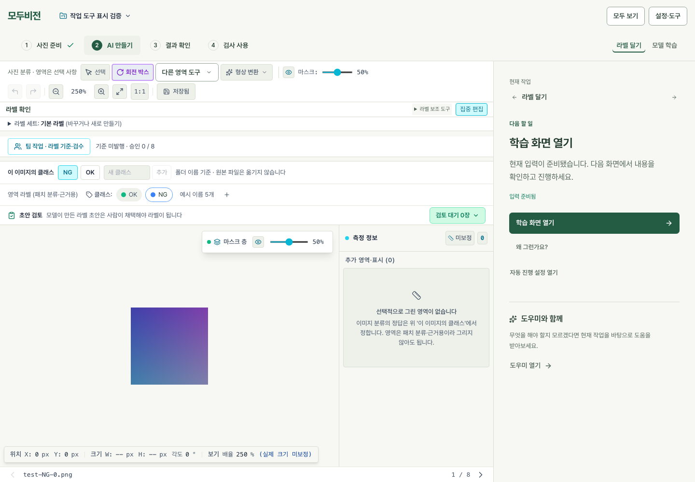
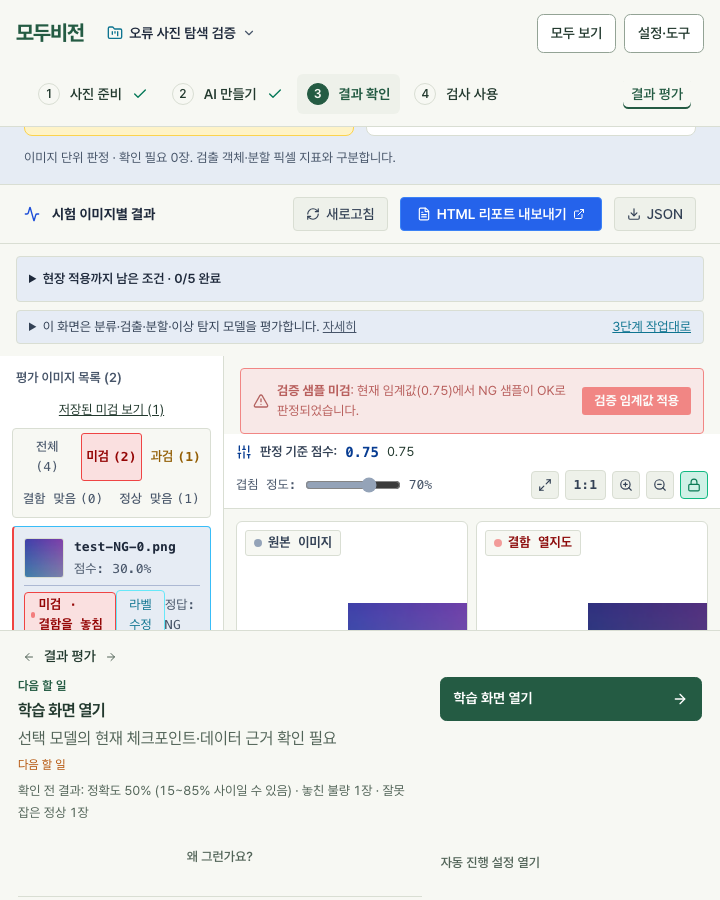
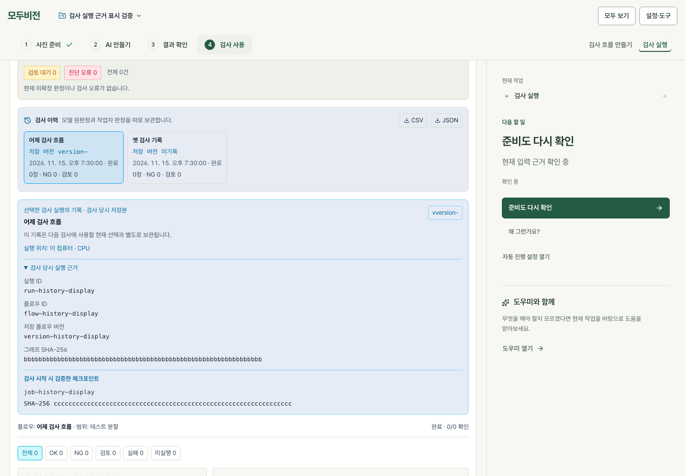

# 작업 중심 화면 개선 검증

기준 main은 `8f1b6051`이고, 구현 브랜치는
`feat/product-workflow-polish-20261116`입니다. 이 문서는 소스와 분리된 개발
검증 결과입니다. 설치 앱·실행 중인 localhost 웹 교체나 현장 수락 기록은
아닙니다. [사용 안내](../task-centered-workbench.md)를 함께 보세요.

## 참고와 실제 반영

| 공개된 작업 방식 | 모두비전에 구현한 동작 |
| --- | --- |
| [Label Studio의 자료·작업 탐색](https://labelstud.io/guide/manage_data), [CVAT의 검토 흐름](https://docs.cvat.ai/docs/manual/advanced/analytics-and-monitoring/manual-qa/) | 작업 종류에 맞는 라벨 도구를 먼저 표시하고, 활성 도구와 분류 정답의 의미를 보존 |
| [Roboflow의 평가 탐색](https://docs.roboflow.com/models/evaluate/evaluate-trained-models), [FiftyOne의 연결된 탐색](https://docs.voxel51.com/user_guide/plots.html) | 오류 숫자에서 실제 오류 사진으로 이동·초점, 기존 필터와 라벨 수정 경로 재사용 |
| [Supervisely의 실험 기록](https://docs.supervisely.com/neural-networks/training/experiments), [MLflow의 모델·자료 기록](https://mlflow.org/docs/latest/ml/tracking/) | 현재 저장 선택과 검사 당시 snapshot을 분리하고 정확한 버전·모델 근거를 펼쳐 확인 |

공식 공개 문서·화면의 상호작용을 참고한 독립 구현입니다. 인증 후 경쟁 제품을
조작한 검증이나 플랫폼 전체 소스 이식이 아닙니다. 새 제품 의존성, 외부
서비스, 회사 로고·원본 사진·플랫폼 번들을 추가하지 않았습니다. n8n 코드는
복사하지 않습니다. 기존 OSS 이식 범위·고지는 그대로 보존합니다.

## 변경한 화면

### 작업에 맞는 라벨 도구

간단히 보기에서 목적별 도구를 먼저 보여줍니다. 단축키나 전체 보기에서 선택한
비우선 도구도 계속 보이며, 메뉴를 접는 것만으로 도구·형상·저장 상태를 바꾸지
않습니다. 도구를 선택하면 사라지는 버튼 대신 안정된 메뉴 제목으로 키보드
초점이 돌아옵니다. 분류의 빈 영역 목록은 사진 정답 부재와 구분합니다.

사진은 소유 합성 PNG입니다. 기존 라벨 로딩 종료와 실제 기본 캔버스의 불투명
원본 RGB를 확인한 뒤 캡처했습니다. 앞선 로딩 중 캡처는 최종 원본 표시의
근거로 재사용하지 않았습니다.

### 결과에서 오류 사진으로

모델·시험 이미지 묶음의 읽기 쉬운 이름은 원래 ID 값을 유지합니다. 미검·과검
카드는 기존 미리보기 필터만 바꾸고 실제 사진 목록으로 이동합니다. 저장된
미검은 별도 기준으로 남습니다. 고급 통계를 접어도 오류·원격 취소 요청·ACK·
worker 종료와 판정 기준 처리 상태가 보입니다.

720px에서 사진이 하단 안내 뒤에 가려지는 경우를 재현하고 기존 초점 이동
소유자를 연결했습니다. 지연된 이동은 프로젝트·컨텍스트 세대·선택 모델이
바뀌면 취소합니다. 실제 사진의 디코딩과 가시 영역을 검증했습니다. 필터의
실제 13px 글자에서 `nowrap` 때문에 두 픽셀이 잘리던 것도 재현해 줄바꿈을
허용했습니다. 다섯 필터의 `scrollWidth <= clientWidth`를 확인합니다.

평가 결과는 UI 표시용 제어 GET입니다. 이 화면의 점수는 모델 성능 근거가
아닙니다. 저장 기준 0.50, 미리보기 0.75의 서로 다른 미검 목록을 검증했습니다.

### 현재 선택과 검사 당시 기록

현재 저장 흐름은 이름과 연결 모델 수를 먼저 보여줍니다. 선택한 과거 검사
기록은 그 실행의 snapshot만 읽으며 현재 모델로 빈 근거를 채우지 않습니다.
전체 run·flow·version·graph·checkpoint ID와 SHA는 기술 근거에 남습니다.

이력과 모델 식별자는 표시용 제어 데이터이며 실행 가능한 검사나 실제 모델
품질을 입증하지 않습니다. 옛 기록의 미기록 경고는 접힌 상세 밖에서도 보입니다.

## 실행한 검증

Node 24.22.1과 기존 Python 3.13 빌드 환경을 사용했습니다.

| 검사 | 결과 |
| --- | --- |
| `npm run test:renderer` — renderer와 main 전체 | 3,515 PASS / 기존 선택형 2 SKIP / 실패 0 |
| `npm run typecheck` | 통과 |
| `npm run typecheck:e2e` | 통과 |
| `npm run build` | 통과, 기존 Vite 큰 번들 경고 유지 |
| `node scripts/generate_light_theme.cjs` | 생성물 갱신 |
| `npm run test:e2e:harness` | 70/70 PASS |
| `python scripts/check_service_plan.py` | 통과, 수락 상태 변경 없음 |
| `python scripts/check_action_evidence.py` | 통과, 과거 실행·승인 기록 변경 없음 |
| 실제 분리 backend/renderer의 `product-workflow-polish.spec.ts` 3건 + `saved-evaluation-threshold-ownership.spec.ts` 1건 | 최종 한 실행 4/4 PASS |
| 독립 코드 검토와 최종 수정 재검토 | 차단 지적 없음 |

실제 브라우저는 밝은 화면·어두운 화면, 720px, 도우미가 열린 라벨 화면,
키보드·초점, 원본 이미지 디코딩·캔버스 RGB, 읽기 실패와 저장 기준을 확인했습니다.
8장 원본 SHA는 매 사례에서 보존됐습니다. 새 학습·검사 실행·GPT 호출은
0건이며 분리 backend는 정상 종료·포트 닫힘·잔여 PID 없음으로 확인했습니다.

원래 실패 기록은 삭제하지 않았습니다. 초기 네 문구/컴포넌트 기대값, 새 import의
엄격한 fixture mock, 사진 이동과 필터 잘림의 RED를 각각 보존했습니다. 기존
비활성 조건·요청·저장값·선택한 실행 B·키보드 단언은 유지했습니다.
[현재 소스 선언 변경](2026-11-16-product-workflow-source-delta.json)은 소스 바인딩
3개만 갱신하며 과거 영수증의 새 실행이나 수락으로 계산하지 않습니다.

## 남는 경계

- 전체 제품 premium 정적 감사에는 기존 32개 지적이 남습니다. 지적된 코드 문맥은
  기준 main과 같고 새로 추가한 문맥의 지적은 0개입니다. 전체 제품의 접근성
  적합성이나 서비스 출시 수락을 통과했다고 주장하지 않습니다.
- 브라우저 콘솔 오류 0건이 아닙니다. 일반 fixture의 `/api/local-host/status`
  404, 표시용 흐름의 실제 backend 미등록 자료/초안/활성 기록 409·404와
  내보내기 선행조건 422가 기록됐습니다. 평가 503은 의도한 읽기 실패 시험입니다.
  새 관측기는 HTTP 경로와 상태를 보존하며 실패를 숨기지 않습니다.
- 실제 학습·현장 품질·native Windows·모든 전문 모델의 도우미 자동화는 이번
  검증 범위 밖입니다. 고정 전처리는 기존 분류·영역 분할 지원 범위를 유지합니다.
- 실험 비교와 데이터 품질 탐색을 더 연결하는 작업, 전문 모델별 도우미 typed
  action 확장, 초보 사용자의 실제 완주 측정은 후속입니다. 이 세 화면 정리로
  모두 완료됐다고 취급하지 않습니다.
- 원격 CI는 최종 PR head에서 별도 확인합니다. 현재 실행 중인 앱·8443·계정·TLS·
  프로젝트·라벨·가이드 원본·다른 작업트리는 변경하지 않았습니다.
