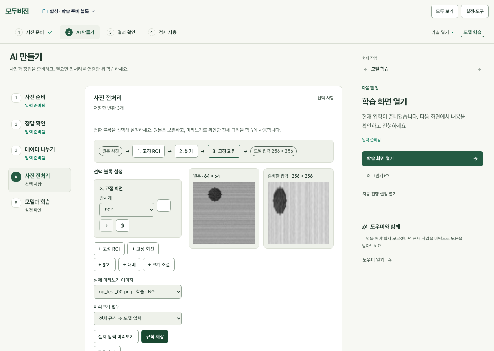
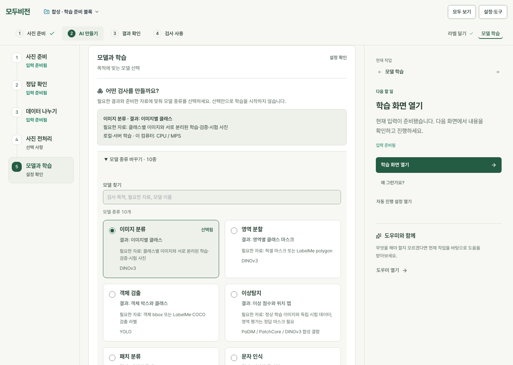

# REA로 확인한 Supervisely와 학습 준비 화면

2026-11-16에 REA를 실제 실행해 공개 페이지를 확인하고, 모두비전의 학습 준비 화면에 반영했습니다.

## 실제 실행 범위

- 별도 도구 폴더의 Node **24.22.1**, REA **6.9.0**을 사용했습니다. 기존 기본 Node와 앱·웹 실행 환경, 제품 의존성, MCP 등록 설정은 바꾸지 않았습니다.
- Node 공식 darwin-arm64 압축 파일을 공식 SHASUMS256과 비교했고, REA 배포 파일도 npm registry의 SHA512 integrity와 비교한 뒤 설치했습니다. 공식 체크섬과 배포 메타데이터 일치 확인이며 별도의 서명 신뢰 사슬 검증을 뜻하지 않습니다.
- REA 시나리오 검증 3건과 실제 브라우저 캡처 3건이 성공했습니다. 각 시나리오는 새 브라우저 프로필로 공개 URL을 열고 기다린 뒤 화면·접근성 트리·최종 URL을 기록했습니다.
- 캡처 뒤 도구가 소유한 브라우저·임시 프로필이 남지 않았음을 확인했습니다. 사용자 브라우저 프로필과 로그인 정보는 사용하지 않았습니다.

| 관찰한 공개 페이지 | 실제 캡처 |
| --- | --- |
| [Model Training](https://supervisely.com/model-training/) | 소개 화면, 학습 UI 예시의 상단 |
| [Pipelines](https://docs.supervisely.com/data-organization/operations-with-data/pipelines) | 공개 설명과 연결 노드 예시 |
| [Experiments](https://docs.supervisely.com/neural-networks/training/experiments) | 공개 설명과 실험 설정·결과 예시 |

이는 인증 후 제품 화면을 조작하거나 모델을 학습한 검증이 아닙니다. 문서에 포함된 전체 wizard/Pipelines 원본 이미지도 별도로 확인해 배치 비교에 사용했습니다. 원본 사이트의 쿠키 배너나 계정 등록은 처리하지 않았습니다. 페이지를 여는 동안 발생하는 사이트 자체의 일반 리소스 요청까지 없었다고 주장하지 않습니다.

실행 명령·종료 코드·배포 해시·원본 REA JSON·스크린샷·임시 프로세스 정리 기록은 작업 공간의 `.superpowers/sdd/2026-11-16-rea-supervisely/`에 보존합니다. 도구 설치 위치는 `/Users/kai/.local/share/modu-vision-tools/rea-6.9.0-20261116`이며 제품 배포물에 포함하지 않습니다.

## 반영한 상호작용

| 참고한 구조 | 모두비전 구현 |
| --- | --- |
| 단계 목록을 유지하고 현재 단계만 크게 편집 | 왼쪽 준비 단계와 오른쪽 설정 패널, 좁은 화면에서는 가로 탐색 |
| 한 단계 안에서 목적과 입력을 선택 | 모델 목적을 설명하는 선택 카드와 필요한 자료·실행 지원 안내 |
| 다음 설정과 최종 실행 분리 | 이전/다음은 탐색만 수행, 새 학습의 설정과 시작은 마지막 모델 단계 안에 배치 |
| 노드 설정과 미리보기 | 전처리 블록 선택·순서 편집, 선택 블록까지의 결과와 전체 학습 입력 결과 비교 |
| 설정·실행 기록 연결 | 기존 저장 규칙과 작업·분할·모델 출처 기록을 사용하고 현재 작업의 상태·중단·복구는 단계 밖에 유지 |

선택 블록 미리보기는 해당 블록까지의 실제 연산만 기존 백엔드로 보냅니다. 뒤의 블록이 빠진 결과로 전체 규칙을 저장할 수 없습니다. 마지막 블록까지 포함한 요청은 전체 규칙과 같으므로 같은 저장 자격을 가집니다. 화면에는 선택 범위를 적용한 뒤 모델 입력 크기로 맞춘 결과라고 표시합니다.

고정 전처리 지원 범위는 기존 **분류·영역 분할**을 유지합니다. 입력 자료·정답·분할·저장·학습 권한과 원본 보존, 검증·시험의 분리는 기존 실행 경로가 판단합니다. 전문 모델과 AutoDL 작업대는 설정과 현재 작업 제어가 자체 결합돼 있어 통째로 숨겨진 패널에 넣지 않았습니다. 이 화면은 모든 모델의 임의 분기형 학습 DAG나 Supervisely 기능 전체를 재현한 것이 아닙니다.

## 코드와 라이선스 범위

[REA](https://github.com/morluto/rea)는 MIT 라이선스의 분석 도구입니다. [Supervisely SDK](https://github.com/supervisely/supervisely/blob/master/LICENSE)는 Apache-2.0이지만 [플랫폼 본체](https://supervisely.com/eula/)와는 범위가 다릅니다. 이번 구현은 공개된 화면과 설명에서 상호작용을 참고한 독립 React 구현이며, 플랫폼 번들이나 회사 로고·원본 사진을 모두비전 제품 코드에 포함하지 않습니다.

개발·화면 검증 결과와 원격 CI, 설치된 앱·실행 중인 웹의 업데이트 상태는 별도로 기록합니다.

## 구현 검증

- Renderer/main 회귀: **3,443 통과 / 기존 opt-in 2 건너뜀 / 실패 0**.
- Typecheck, E2E typecheck, main/renderer build 통과. 기존 Vite 큰 번들 경고는 유지합니다.
- 실제 격리 renderer/backend 브라우저 시험에서 부분 미리보기의 저장 거절, 마지막 prefix와 전체 규칙의 hash·PNG 동등성, 저장 분할 보존과 명시 변경, 최종 단계 전용 학습 시작, 설정 오류 복구와 실제 포커스를 확인했습니다.
- 720px 가로 rail과 820px 세로 rail에서 방향키·선택 노출·문서 가로 넘침 없음을 확인했습니다. 합성 원본 64장 해시 보존, 모델 실행·compute probe·외부 요청·페이지 오류 0건, 격리 프로세스 잔여 0건입니다.
- 독립 검토에서 발견한 오래된 저장 콜백과 프로젝트 전환 후 복구 콜백의 상태 변경 문제는 회귀로 재현하고 범위 검사로 보완했습니다. 추가 차단 지적은 없었습니다.
- 설치된 앱·기존 웹 서버 교체 및 원격 CI 전체 성공을 이 로컬 검증 결과로 대신하지 않습니다.

위 두 화면은 모두비전의 합성 자료를 사용한 실제 개발 검증 캡처입니다.
