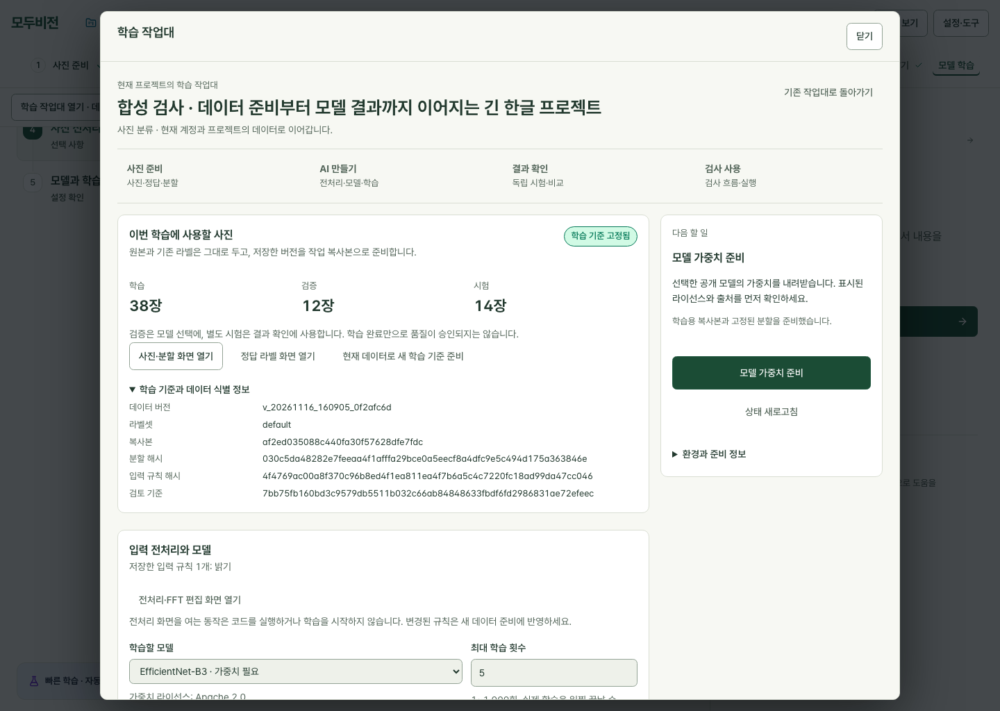
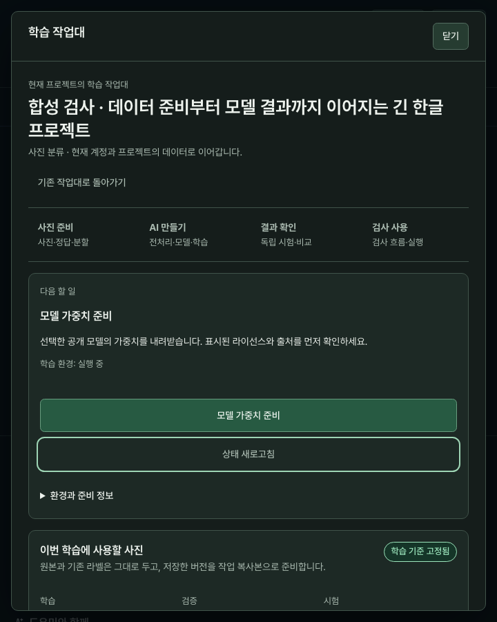
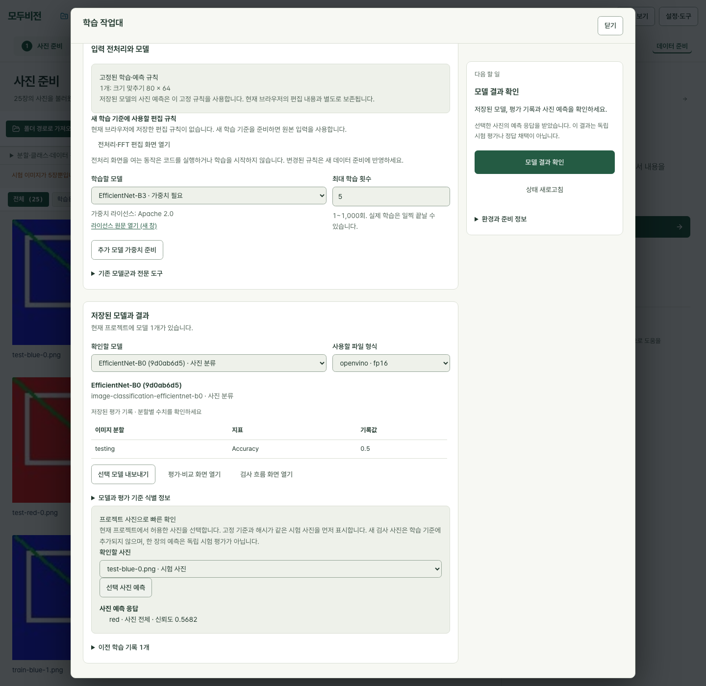
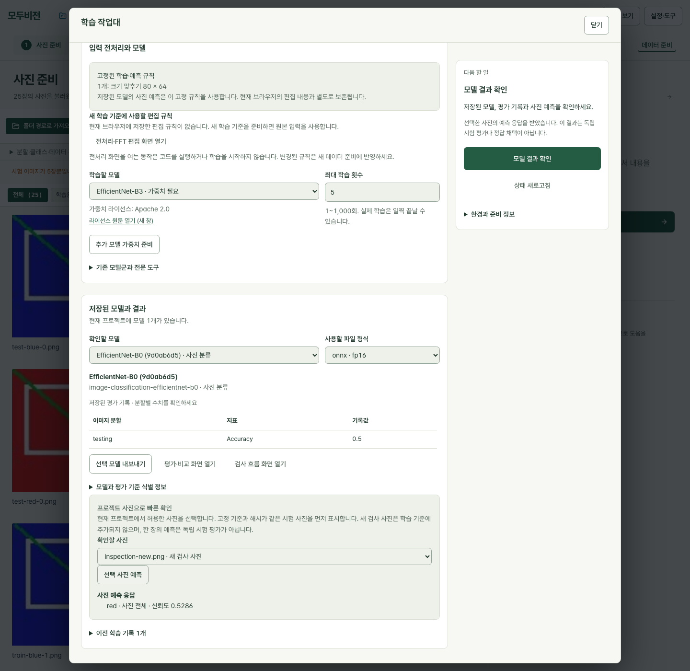

# Geti 학습 작업대 UI 검증

`PlatformWorkspace`는 현재 모두비전 계정·프로젝트를 그대로 사용하며 실제
`/api/platform/geti` API를 호출한다. 화면을 열거나 다시 연결하는 동작은 조회만
한다. 환경 시작, 데이터 복사, 공개 가중치 준비, 학습, 예측, 라벨 채택은 각
버튼을 눌러야 실행된다.

사진 준비 → AI 만들기 → 결과 확인 → 검사 사용은 기존 1–6단계로 이동한다.
이동 전 편집 저장과 라벨셋 전환은 기존 프로젝트 저장소가 담당한다. 라벨
채택은 검토 권한과 기준 revision을 확인해 새 버전을 만든다. 저장 후 별도
`채택한 라벨로 라벨 화면 열기`를 눌러야 그 라벨셋이 선택되며 이전 라벨셋은
보존된다.

시맨틱 분할 프로젝트는 기존 모델 도구가 기본 경로다. 별도 개체별 분할 선택은
각 개체의 저장된 다각형 라벨만 사용하며 프로젝트 종류를 바꾸지 않는다.
브러시·시맨틱 마스크와 고정 전처리·FFT 규칙을 자동 변환하지 않는다. 기존
10개 모델군은 기존 학습 카탈로그에서 계속 접근할 수 있다.

제출 결과가 불확실하면 같은 학습을 다시 제출하지 않는다. 저장 상태를 읽거나
명시적인 `실행 환경 종료하고 작업 상태 정리`로 소유 환경의 종료 증거를
확인한다. 중단 요청과 작업자 종료, 학습 완료와 독립 시험·현장 품질 승인은
서로 구분한다.

## 빠른 검증

```sh
node --require ./scripts/test_ts_dependencies.cjs --test src/renderer/components/platform/platformWorkflow.test.cjs
npm run typecheck
npm run typecheck:e2e
```

## 실제 앱·브라우저 검증 선택

일반 CI는 Geti Python 3.14와 모델 런타임을 제공하지 않는다. 실제 플랫폼
E2E는 `MV_E2E_GETI_PLATFORM=1`로 별도 선택한다. 선택하지 않은 검사는 사유를
기록하며 건너뛰고, 이 결과를 플랫폼 실행 검증으로 해석하지 않는다. API·소스
및 컨트롤러의 일반 단위 검사는 이 선택과 무관하게 실행된다.

검증된 설치 descriptor를 사용할 때:

```sh
MV_E2E_GETI_PLATFORM=1 \
MV_E2E_PYTHON=/absolute/path/to/parent-python3.13 \
MODU_GETI_RUNTIME_DESCRIPTOR=/absolute/path/to/geti/runtime.json \
npx playwright test scripts/e2e/geti-platform.spec.ts --project=browser --project=electron
```

소유한 소스 개발 환경을 검증할 때는 descriptor 대신 별도 Python과 고정된 전체
소스·검토된 overlay를 지정한다:

```sh
MV_E2E_GETI_PLATFORM=1 \
MV_E2E_PYTHON=/absolute/path/to/parent-python3.13 \
MODU_GETI_PYTHON=/absolute/path/to/geti-python3.14 \
MODU_GETI_SOURCE_ROOT="$PWD/platforms/geti/upstream" \
MODU_GETI_ENTRYPOINT="$PWD/platforms/geti/runtime/server.py" \
npx playwright test scripts/e2e/geti-platform.spec.ts --project=browser --project=electron
```

검사는 기존 E2E harness가 만든 프로필·임시 저장소·동적 포트와 합성 사진을
사용한다. 실제 전처리 미리보기·규칙 저장, child 시작, 데이터 복사·readback,
원본 해시 보존, 503 조회 복구, 720px·키보드·두 테마, 시맨틱 기본 경로와
명시적 개체별 분할 선택, 기존 10개 모델군 접근을 확인한다. 가중치 다운로드,
학습 제출, GPT 요청, 현장 사진, 설치된 사용자 앱과 8443 서비스는 사용하지
않는다. 실행별 manifest·스크린샷·결과는 harness run 폴더에 남는다.

## 11월 17일 독립 검토 이후 재확인

복사본이 바뀌면 이전 검토 체크·채택 결과·사진 선택·예측·페이지 상태를 무효화한다. 같은 복사본을 새로 읽을 때는 유효한 상태를 보존한다. 이전 복사본의 늦은 사진·예측·채택 응답은 새 복사본의 화면을 채우지 못한다. 이 회귀를 포함한 컨트롤러 검사32개와 독립 재검토가 통과했다.

수정 뒤 실제 브라우저20.6초·Electron22.7초, 전체59.0초에2개 경로가 통과했다. 원본64장과38/12/14분할, 입력 규칙 SHA `4f4769ac00a8f370c96b8ed4f1ea811ea4f7b6a5c4c7220fc18ad99da47cc046`를 다시 확인했다. 설치 제품·학습 이후 화면의 범위는 위와 같이 별도다.

검증을 위해 상세 식별 정보를 펼친 합성 화면이다. 평소에는 접어 두고 오른쪽 다음 행동을 따른다.





## 저장된 모델 결과의 실제 HTTPS 브라우저 확인

2026년 11월 17일에는 합성 프로젝트에서 이미 완료된 EfficientNet-B0 작업을 다시 열었다. 새 HTTPS origin에서 실제 계정 로그인과 프로젝트 선택을 거쳤으며, 저장된 모델의 `크기 맞추기 80 × 64` 규칙과 새 브라우저의 비어 있는 편집 규칙을 따로 표시하는지 확인했다. 실제 평가 DTO의 testing Accuracy `0.5`가 표시됐다. 이 합성 수치는 제품 품질 승인 결과가 아니다.

Library revision을 새로 활성화하지 않고 프로젝트에서 허용한 사진 25장을 불러왔다. 고정 학습 기준 24장과 `새 검사 사진` 1장을 구분하며, 학습·검증·시험 수는 16/4/4로 유지했다. OpenVINO는 고정된 시험 사진을, ONNX는 새 검사 사진을 실제로 예측했다. 두 응답 모두 저장된 입력 규칙 SHA와 원본 사진 SHA가 일치했다.

로그인한 브라우저에서 내려받은 ZIP은 OpenVINO `model.xml`·`model.bin`, ONNX `model.onnx`를 포함했다. 실제 파일 SHA-256은 각각 `f700cba8bde82d43288ea420e7d00e889e2eb21f429508d1ceef3ba8f199e5db`, `e5654071e82336b2f82a996a6d38e9edb6a83d8f6d183e4fc081e8e214344ddc`로 응답 헤더와 일치했으며, 로그인 없는 다운로드는 401로 거절됐다.

최종 실행은 42.156초에 통과했다. 첫 상태 HTTP 응답은 6.714초였고, 기존 작업 ID·고정 데이터·원본 사진 25장의 해시를 보존했다. 추가 학습·데이터 준비·가중치 다운로드·라벨 채택·GPT 호출은 실행하지 않았다. 소유한 부모와 자식 프로세스 종료, 포트 닫힘, 외부 요청과 브라우저 오류가 없는 것도 확인했다. 이 결과는 소스 부모 서버와 실제 portable Geti 런타임을 연결한 브라우저 검증이며, 설치 제품의 모델 결과 검증으로 확대하지 않는다.

실행 도구는 완료된 **소유 합성 QA 저장소**만 선택한다. 기존 receipt를 덮어쓰지 않고 실행별 TLS·로그·다운로드·스크린샷·receipt를 새 디렉터리에 저장한다.

```sh
node scripts/qa/geti_browser_model_results.cjs \
  --root /absolute/path/to/completed-synthetic-integrated-qa \
  --descriptor /absolute/path/to/geti/runtime.json \
  --python /absolute/path/to/parent-python3.13
```

증거: `.superpowers/sdd/2026-11-16-full-training-platform/integrated-qa-20261117-v2/browser-results-2026-11-16T17-14-19-230Z/receipt.json`. 앞선 409 실패와 수정 전후 회귀 로그도 별도 실행 디렉터리에 보존했다. 최종 플랫폼 검사 36개와 도우미 기능 목록 검사 19개, 두 TypeScript 설정의 검사도 통과했다.




